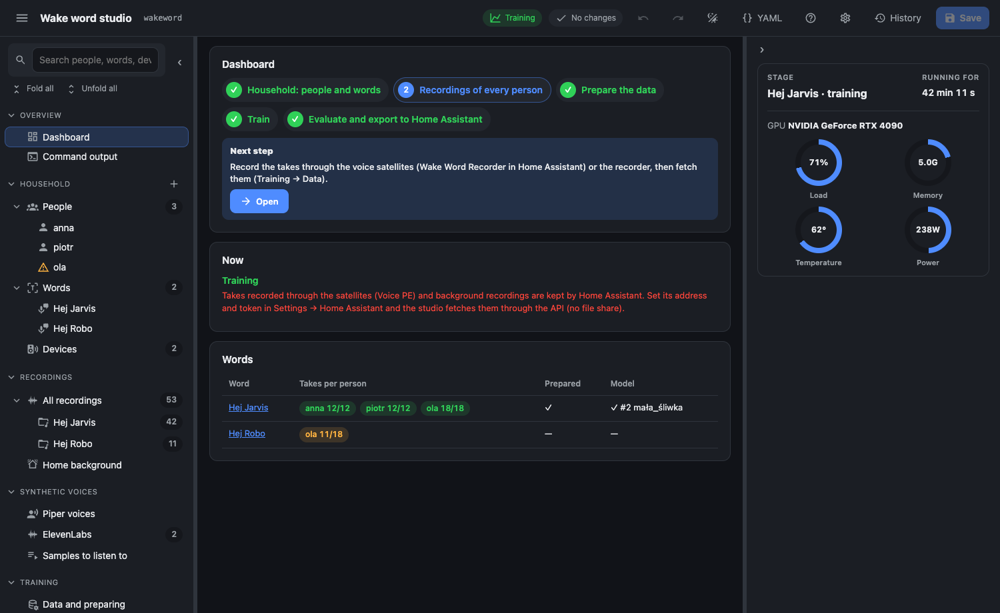

# Custom wake words for Home Assistant Voice

**English** · [Polski](README.pl.md)

Tools to train **your own wake words** (microWakeWord) for the Home Assistant Voice Preview Edition
and other ESPHome devices — on **recordings of your household**, with your accent.

- **Words for the whole family**: one shared word ("Dżarwis"), personal words for the kids in their
  rooms ("Optimus Prime", "Wajana") — each word is trained on recordings of everyone who uses it.
- **A dozen or so takes per person** is enough — voice expansion, augmentation and speech synthesis do the rest.
- **Accent from the data**: household recordings + native-language Piper voices reading phonetic spellings.
- **Studio in the browser**: an editor like the Home Dashboard editor — people, words, devices, recordings from Home Assistant, live training, models and export; runs in Docker on the GPU machine, behind a login, no command line.
- **Browser recorder** for phones, with instructions on how to say each take.
- **Recording through Voice PE**: the *Wake Word Recorder* HA integration — the device guides the takes with the very microphones that will later listen for the word ([03](docs/en/03-recording.md)).
- **Per-person evaluation**: does the model work for the kids as well as for the adults, how many false wakes per hour.
- **Ready-made ESPHome files**: a manifest and a YAML snippet for every device (2 words per Voice PE).

The studio runs on the Ubuntu machine with the RTX 4090 and starts with it; open it in a browser on the Mac, an
iPad or a phone. Home Assistant switches the machine on, the studio can switch it off — also by itself after a training.



## Try it on a Mac

You only need **Docker Desktop**, running. No GPU, no Python and no Home Assistant.

```bash
make demo        # builds the demo image (about 20 s the first time) and runs it
```

Open <http://localhost:8766> and log in with `demo` / `demo`. Everything is pretend and stays in the container: a made-up
household and a fake GPU, nothing goes to Home Assistant or to the GPU machine. Ctrl+C stops it and removes the
container; `make demo-clean` removes the image too. The documentation: `make docs` (also in Docker). For the
developer: `make test` and `make test-browser` need `make setup` (uv, which fetches Python itself; Chrome).

## Wake word studio (Docker on the GPU machine)

The training panel as an editor like the Home Dashboard and Assist Router editors — tree, draft with undo and history, YAML — running in Docker on the Ubuntu machine with the GPU and starting with it, behind a login. Install from the Mac: `make install` (the machine's address in `~/.config/gpu-studio/host.mk`, shared by every studio), updates `make deploy`, login `make login`, state `make status`, log `make logs`, or on the machine `docker/install-ubuntu.sh` ([11](docs/en/11-studio.md)); try it on a Mac: `make demo`. The documentation with screenshots is in the studio under **?** and as a site: `make docs`. How to train well, every parameter and what it does: [12](docs/en/12-training-well.md).

## How I run it: hardware and support

This project was built for, and tested on, exactly one setup:

- **Ubuntu 24.04 with an NVIDIA GeForce RTX 4090 (24 GB)** — the studio in Docker: data preparation, training (microWakeWord, TensorFlow) and the model tests;
- **macOS** — the browser with the studio, `make install`/`deploy` and the demo to try it (Docker Desktop).

All scripts (`train/train.sh`, TensorFlow with CUDA, batch sizes and memory settings) are prepared for this card. **The project will not be adapted to other GPUs,
other machines or other operating systems.** You are welcome to use it (MIT license), but supporting
your own hardware is up to you. Please don't open issues or requests to add other cards.

## The Home Assistant integration

Recording takes through Voice PE satellites is done by **Wake Word Recorder**, a separate public
repository: [home-assistant-wake-word-recorder](https://github.com/witold-gren/home-assistant-wake-word-recorder) (install it with HACS as described there). It writes the
takes into the household folder this toolkit uses.

The toolkit itself (studio, training) is not installed in Home Assistant; it runs in Docker on the GPU
machine. The commands below are the toolkit on the Mac (recordings, checks) for the developer.

## Quick start

```bash
curl -LsSf https://astral.sh/uv/install.sh | sh  # uv once (it fetches Python 3.12 itself); ffmpeg only for .m4a
make setup && source .venv/bin/activate

export WAKEWORD_HOUSEHOLD=households/home
wakeword init --ui-language en --speaker dad --speaker mum --speaker ola:child
wakeword add-word dzarwis "Dżarwis" --language pl --spelling "pl=dżarwis,dżarwys" --spelling "en=jarvis"
wakeword set-device living-room-voice dzarwis okay_nabu

wakeword record            # https://<mac-ip>:8443/ on the phones
wakeword check             # speaker × word matrix
wakeword preview dzarwis   # listen to the augmentation
wakeword prepare --all     # split + expand + synthetic + config

# on the NVIDIA machine:
train/train.sh households/home --all
# (it also runs the household test of the models: wakeword evaluate-models <word> --missing)

# back on the Mac:
wakeword evaluate dzarwis
wakeword export --all --cutoff 0.97
```

## Make — every step with one command

```bash
make help                       # the steps in order (Polish with LANG=pl_*, or HELP_LANG=pl)
make setup                      # .venv environment and install (also done by the first command)
make record                     # recorder on this computer
make check                      # person × word matrix
make prepare WORDS=dzarwis_test # prepare the chosen words
```

The household folder defaults to `~/home-assistant/wakeword` (on the computer that trains; the studio fetches the satellites' takes from Home Assistant through its API); another one: `make check H=/other/path`.

## Documentation

| | Chapter |
|---|---|
| 00 | [How it works](docs/en/00-how-it-works.md) — why training from scratch, FRR, cutoff, window, glossary |
| 01 | [What you need](docs/en/01-what-you-need.md) — hardware, installation, time, children's privacy |
| 02 | [Plan your household and choose words](docs/en/02-plan-your-household.md) — `household.yaml`, shared and personal words, devices |
| 03 | [Household recordings](docs/en/03-recording.md) — how many takes, variants, recorder, import, checks |
| 04 | [Augmentation and negatives](docs/en/04-augmentation-and-negatives.md) — voice expansion, preview, negative datasets |
| 05 | [Synthetic data](docs/en/05-synthetic-data.md) — Piper, phonetic spellings, accent |
| 06 | [Training step by step](docs/en/06-training.md) — `prepare`, `train/train.sh` |
| 07 | [Evaluation and choosing the cutoff](docs/en/07-evaluation.md) — per-person FRR, false wakes/h |
| 08 | [Deploying to ESPHome](docs/en/08-deployment.md) — manifest, YAML, OTA, the two Voice PE slots |
| 09 | [Iterating](docs/en/09-iterating.md) — false wakes, extra takes, retraining |
| 10 | [Alternatives](docs/en/10-alternatives.md) — microWakeWord notebook, wakesmith, TaterTotterson, openWakeWord |
| 11 | [Wake word studio](docs/en/11-studio.md) — Docker on the GPU machine, login, the editor, draft and history, power off after training |
| 12 | [Training a good wake word](docs/en/12-training-well.md) — how many takes, every parameter and its effect, reading results, recipes |

## Commands

| Command | What it does |
|---|---|
| `init`, `add-speaker`, `add-word`, `set-device` | create and edit `household.yaml` |
| `record`, `make-cert` | web recorder (HTTPS with a self-signed certificate) |
| `import` | import audio files (m4a, mp3, wav …) as takes |
| `check` | check recordings: speaker × word matrix, problems |
| `split` | set aside test takes per person |
| `expand` | expand training takes (pitch/formants, tempo) |
| `preview` | augmentation examples to listen to |
| `synthetic` | speech synthesis script for the training machine |
| `config` | microWakeWord training configuration |
| `prepare` | `split` + `expand` + `synthetic` + `config` |
| `evaluate` | FRR per person and group, false wakes/h, cutoff table |
| `export` | model manifest and YAML snippets for devices |

`wakeword <command> --help` shows all options.

## Layout

```
wakeword/              Python package (CLI, recorder, audio processing)
wakeword/languages/    recorder language packs (en, pl) — add your own by copying en.py
train/                 training recipe for the NVIDIA machine
households/examples/   examples: family (family, 3 words, 4 devices), single (one person)
docs/pl, docs/en       documentation
tests/                 tests (pytest)
```

Recordings and everything derived from them (`households/*/data/`) never go into git.

## Tests

```bash
pytest      # toolkit (.venv); checks against Wake Word Recorder when its repository is next to this one
```

## License

MIT — see [LICENSE](LICENSE). The public datasets used in training have their own licenses;
treat trained models as intended for private, non-commercial use.
