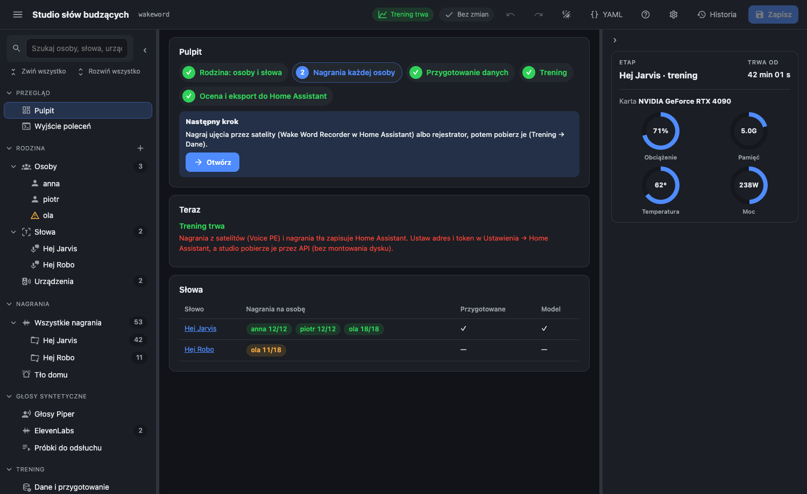

# Własne słowa wybudzające dla Home Assistant Voice

[English](README.md) · **Polski**

Narzędzia do wytrenowania **własnych słów wybudzających** (microWakeWord) dla Home Assistant Voice
Preview Edition i innych urządzeń ESPHome — na **nagraniach domowników**, z ich akcentem.

- **Słowa dla całej rodziny**: jedno słowo wspólne („Dżarwis”), słowa osobiste dzieci w ich
  pokojach („Optimus Prime”, „Wajana”) — każde słowo trenowane na nagraniach wszystkich, którzy go używają.
- **Kilkanaście nagrań na osobę** wystarczy — rozmnożenie głosu, augmentacja i synteza mowy robią resztę.
- **Akcent z danych**: nagrania domowników + polskie głosy Piper czytające zapis fonetyczny.
- **Studio w przeglądarce**: edytor jak Edytor Home Dashboard — osoby, słowa, urządzenia, nagrania z Home Assistanta, trening na żywo, modele i eksport; działa w Dockerze na maszynie z GPU, za logowaniem, bez wiersza poleceń.
- **Rejestrator w przeglądarce** na telefonach, z instrukcją, jak powiedzieć każde ujęcie.
- **Nagrywanie przez Voice PE**: integracja HA *Wake Word Recorder* — urządzenie samo prowadzi nagrania tymi mikrofonami, które potem słuchają słowa ([03](docs/pl/03-recording.md)).
- **Ocena na osobę**: czy model działa dla dzieci tak samo jak dla dorosłych, ile fałszywych wybudzeń na godzinę.
- **Gotowe pliki dla ESPHome**: manifest i fragment YAML dla każdego urządzenia (2 słowa na Voice PE).

Studio działa na Ubuntu z kartą RTX 4090 i startuje razem z maszyną; otwierasz je w przeglądarce z Maca, iPada
albo telefonu. Home Assistant włącza maszynę, a studio umie ją wyłączyć — także samo po treningu.



## Wypróbuj na Macu

Wystarczy **Docker Desktop**, uruchomiony. Bez GPU, bez Pythona i bez Home Assistanta.

```bash
make demo        # buduje obraz demo (za pierwszym razem ok. 20 s) i go uruchamia
```

Otwórz <http://localhost:8766> i zaloguj się `demo` / `demo`. Wszystko jest udawane i zostaje w kontenerze: wymyślona
rodzina i udawane GPU, nic nie trafia do Home Assistanta ani na maszynę z GPU. Ctrl+C zatrzymuje i usuwa
kontener; `make demo-clean` usuwa też obraz. Dokumentacja: `make docs` (też w Dockerze). Dla programisty:
`make test` i `make test-browser` potrzebują `make setup` (uv, który sam pobiera Pythona; Chrome).

## Studio słów budzących (Docker na maszynie z GPU)

Panel treningu jako edytor, taki jak Edytor Home Dashboard i Assist Router — drzewo, szkic z cofaniem i historią, YAML — działający w Dockerze na Ubuntu z kartą graficzną i startujący razem z nią, za logowaniem. Instalacja z Maca: `make install` (adres maszyny w `~/.config/gpu-studio/host.mk`, wspólny dla wszystkich studiów), aktualizacje `make deploy`, login `make login`, stan `make status`, log `make logs`, albo na maszynie `docker/install-ubuntu.sh` ([11](docs/pl/11-studio.md)); na Macu do wypróbowania: `make demo`. Dokumentacja ze zrzutami jest w studiu pod **?** i jako strona: `make docs`. Jak dobrze trenować, każdy parametr i jego wpływ: [12](docs/pl/12-training-well.md).

## Jak to u mnie działa: sprzęt i wsparcie

Projekt powstał i był sprawdzany na dokładnie jednym zestawie:

- **Ubuntu 24.04 z kartą NVIDIA GeForce RTX 4090 (24 GB)** — studio w Dockerze: przygotowanie danych, trening (microWakeWord, TensorFlow) i testy modeli;
- **macOS** — przeglądarka ze studiem, `make install`/`deploy` i demo do wypróbowania (Docker Desktop).

Wszystkie skrypty (`train/train.sh`, TensorFlow z CUDA, rozmiary paczek i ustawienia pamięci) są przygotowane pod tę kartę. **Projekt nie będzie dostosowywany do
innych kart, innych maszyn ani innych systemów.** Każdy może z niego korzystać (licencja MIT), ale
wsparcie dla własnego sprzętu musi zapewnić sam. Proszę nie zgłaszać próśb o dodanie innych kart.

## Integracja Home Assistant

Nagrywanie przez satelity Voice PE obsługuje **Wake Word Recorder**, osobne publiczne repozytorium:
[home-assistant-wake-word-recorder](https://github.com/witold-gren/home-assistant-wake-word-recorder) (instalacja przez HACS opisana tam). Zapisuje nagrania do folderu
domu, z którego korzysta to narzędzie.

Samo narzędzie (studio, trening) nie instaluje się w Home Assistancie; działa w Dockerze na komputerze
z GPU. Polecenia poniżej to narzędzie na Macu (nagrania, kontrola) dla programisty.

## Szybki start

```bash
curl -LsSf https://astral.sh/uv/install.sh | sh  # uv raz (sam pobiera Pythona 3.12); ffmpeg tylko do .m4a
make setup && source .venv/bin/activate

export WAKEWORD_HOUSEHOLD=households/dom
wakeword init --ui-language pl --speaker tata --speaker mama --speaker ola:child
wakeword add-word dzarwis "Dżarwis" --language pl --spelling "pl=dżarwis,dżarwys" --spelling "en=jarvis"
wakeword set-device salon-voice dzarwis okay_nabu

wakeword record            # https://<ip-maca>:8443/ na telefonach
wakeword check             # macierz osoba × słowo
wakeword preview dzarwis   # posłuchaj augmentacji
wakeword prepare --all     # split + expand + synthetic + config

# na maszynie z NVIDIA:
train/train.sh households/dom --all
# (od razu też test domowników modeli: wakeword evaluate-models <słowo> --missing)

# z powrotem na Macu:
wakeword evaluate dzarwis
wakeword export --all --cutoff 0.97
```

## Make — wszystkie kroki jednym poleceniem

```bash
make help                       # lista kroków po kolei (po polsku przy LANG=pl_*, albo HELP_LANG=pl)
make setup                      # środowisko .venv i instalacja (robi się też samo przy pierwszym poleceniu)
make record                     # rejestrator na tym komputerze
make check                      # macierz osoba × słowo
make prepare WORDS=dzarwis_test # przygotowanie wybranych słów
```

Folder rodziny domyślnie `~/home-assistant/wakeword` (na komputerze, który trenuje; nagrania z satelitów studio pobiera z Home Assistant przez API); inny: `make check H=/inna/ścieżka`.

## Dokumentacja

| | Rozdział |
|---|---|
| 00 | [Jak to działa](docs/pl/00-how-it-works.md) — dlaczego trening od zera, FRR, próg, okno, słowniczek |
| 01 | [Co przygotować](docs/pl/01-what-you-need.md) — sprzęt, instalacja, czas, prywatność dzieci |
| 02 | [Plan rodziny i wybór słów](docs/pl/02-plan-your-household.md) — `household.yaml`, słowa wspólne i osobiste, urządzenia |
| 03 | [Nagrania domowników](docs/pl/03-recording.md) — ile ujęć, warianty, rejestrator, import, kontrola |
| 04 | [Augmentacja i negatywy](docs/pl/04-augmentation-and-negatives.md) — rozmnożenie głosu, podgląd, zbiory negatywne |
| 05 | [Dane syntetyczne](docs/pl/05-synthetic-data.md) — Piper, zapisy fonetyczne, akcent |
| 06 | [Trening krok po kroku](docs/pl/06-training.md) — `prepare`, `train/train.sh` |
| 07 | [Ocena i wybór progu](docs/pl/07-evaluation.md) — FRR na osobę, fałszywe wybudzenia/h |
| 08 | [Wdrożenie w ESPHome](docs/pl/08-deployment.md) — manifest, YAML, OTA, dwa miejsca Voice PE |
| 09 | [Kolejne iteracje](docs/pl/09-iterating.md) — fałszywe wybudzenia, dogrywanie, ponowny trening |
| 10 | [Alternatywy](docs/pl/10-alternatives.md) — notatnik microWakeWord, wakesmith, TaterTotterson, openWakeWord |
| 11 | [Studio słów budzących](docs/pl/11-studio.md) — Docker na maszynie z GPU, logowanie, edytor, szkic i historia, wyłączanie po treningu |
| 12 | [Jak dobrze wytrenować słowo](docs/pl/12-training-well.md) — ile nagrań, każdy parametr i jego wpływ, czytanie wyników, przepisy |

## Polecenia

| Polecenie | Co robi |
|---|---|
| `init`, `add-speaker`, `add-word`, `set-device` | tworzą i zmieniają `household.yaml` |
| `record`, `make-cert` | rejestrator WWW (HTTPS z własnym certyfikatem) |
| `import` | import plików audio (m4a, mp3, wav …) jako ujęć |
| `check` | kontrola nagrań: macierz osoba × słowo, problemy |
| `split` | odłożenie ujęć testowych na osobę |
| `expand` | rozmnożenie ujęć treningowych (wysokość/formanty, tempo) |
| `preview` | przykłady augmentacji do odsłuchu |
| `synthetic` | skrypt syntezy mowy dla maszyny treningowej |
| `config` | konfiguracja treningu microWakeWord |
| `prepare` | `split` + `expand` + `synthetic` + `config` |
| `evaluate` | FRR na osobę i grupę, fałszywe wybudzenia/h, tabela progów |
| `export` | manifest modelu i fragmenty YAML dla urządzeń |

`wakeword <polecenie> --help` pokazuje wszystkie opcje.

## Struktura

```
wakeword/              pakiet Pythona (CLI, rejestrator, przetwarzanie audio)
wakeword/languages/    pakiety językowe rejestratora (en, pl) — dodaj własny, kopiując en.py
train/                 przepis treningowy dla maszyny z NVIDIA
households/examples/   przykłady: family (rodzina, 3 słowa, 4 urządzenia), single (jedna osoba)
docs/pl, docs/en       dokumentacja
tests/                 testy (pytest)
```

Nagrania i wszystko, co z nich powstaje (`households/*/data/`), nie trafia do gita.

## Testy

```bash
pytest      # narzędzie (.venv); ze sprawdzeniem Wake Word Recorder, gdy jego repozytorium leży obok
```

## Licencja

MIT — zobacz [LICENSE](LICENSE). Publiczne zbiory danych używane w treningu mają własne licencje;
wytrenowane modele traktuj jako przeznaczone do użytku prywatnego, niekomercyjnego.
