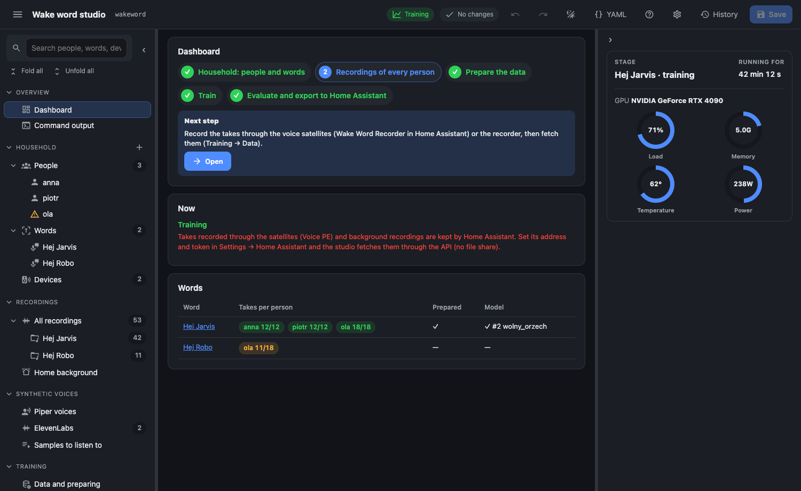
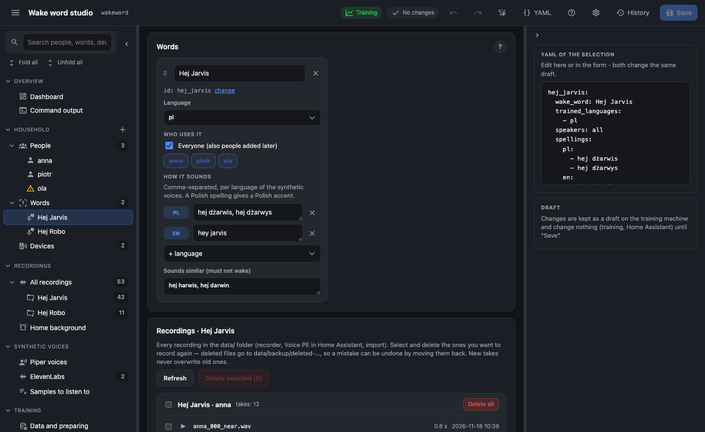
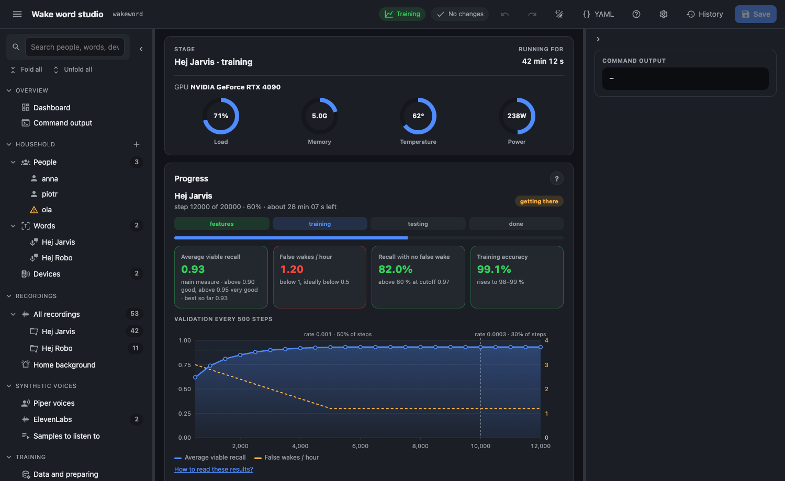
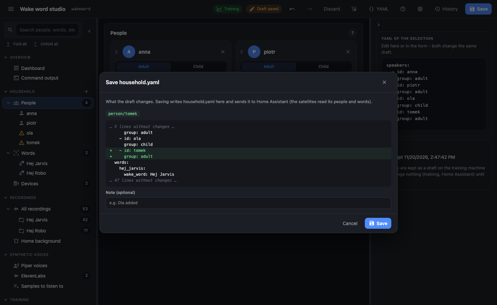

# 11. Wake word studio — the editor on the GPU machine (Docker) {#studio}

The studio is the training panel as an editor, laid out like the Home Dashboard and Assist Router editors: a tree on
the left, the view in the middle, the YAML or the live training on the right, a draft with undo and history. It
runs **only on the machine with the graphics card (Ubuntu + RTX 4090), in a Docker container**, and starts with it —
once the machine is on, open `http://<machine>:8765/`.

Every function in order, from the first word to Voice PE: [13. The studio step by step](13-studio-step-by-step.md).

On a Mac the studio can only be tried — see [Try it on a Mac](#try-on-a-mac). The studio follows the shared standard of the GPU machine's
apps (the same `make` commands, login, top bar and power-off as the Assist Router trainer and Piper Voice Cloner).

## Try it on a Mac {#try-on-a-mac}

You only need **Docker Desktop**, running. No GPU, no Python and no Home Assistant.

```bash
make demo        # builds the demo image (about 20 s the first time) and runs it
```

Open `http://localhost:8766` and log in with `demo` / `demo`. Everything is pretend and stays in the container: a made-up
household and a fake GPU, nothing goes to Home Assistant or to the GPU machine. Ctrl+C stops it and removes the
container; `make demo-clean` removes the image too. The documentation: `make docs` (also in Docker). For the
developer: `make test` and `make test-browser` need `make setup` (uv, which fetches Python itself; Chrome).

## 11.1 Installing on Ubuntu {#installing-on-ubuntu}

Needed once:

1. **NVIDIA driver** — `nvidia-smi` must show the card (`sudo ubuntu-drivers install`, reboot).
2. **Docker Engine and Compose** — [Docker's guide for Ubuntu](https://docs.docker.com/engine/install/ubuntu/),
   then `sudo usermod -aG docker $USER` and log in again.
3. **NVIDIA Container Toolkit** — [NVIDIA's guide](https://docs.nvidia.com/datacenter/cloud-native/container-toolkit/latest/install-guide.html),
   then `sudo nvidia-ctk runtime configure --runtime=docker && sudo systemctl restart docker`.
4. **Disk space** — about 60 GB: the image (~12 GB with TensorFlow and CUDA), augmentation data and negatives
   (~30 GB in `docker/data/work`), the household's recordings and models.

**Easiest from the Mac** (the repository on the Mac, the machine reachable over SSH without a password). Put the
machine's address once for every studio in `~/.config/gpu-studio/host.mk`, and this app's folders in
`Makefile.local` (both outside git):

```make
# ~/.config/gpu-studio/host.mk
GPU_HOST = user@192.168.1.21
```

```make
# Makefile.local - folders of an earlier training without Docker (empty = docker/data next to the repository)
STUDIO_HOUSEHOLD = ~/wakeword-train/household
STUDIO_WORK = ~/wakeword-work
STUDIO_HF = ~/.cache/huggingface
```

```bash
make install   # the first time: code to the machine, login, autostart, build and start
make login     # user and password
make deploy    # every later update
make status    # does the right app answer (the studio, not the demo), version, the card, TensorFlow on the card
make logs      # the studio's log
make stop      # stop the studio; it stays off after a restart too (make deploy starts it again)
make uninstall # remove the studio from the machine: lists what goes and asks for yes; recordings and models stay
```

Then `http://<machine>:8765/`. In the studio set what the container does not take from the Mac: Settings → Home
Assistant (address, token), Machine power and the ElevenLabs key (Voices → ElevenLabs).

Without the Mac, on the machine itself:

```bash
git clone https://github.com/witold-gren/home-assistant-wakeword.git
cd home-assistant-wakeword
docker/install-ubuntu.sh
```

The script checks the driver, Docker and the toolkit, on the first run **writes the login** (`admin` and a random
password in `docker/config/env`, mode 600), starts Docker with the system, builds the image and runs the container
with `restart: unless-stopped`. At the end it shows the card seen in the container and the studio's address.

```bash
docker/install-ubuntu.sh --show-login   # user and password
docker/install-ubuntu.sh --remove       # stop and remove the container (data stays)
```

### Where the data is {#where-the-data-is}

| On the machine | In the container | What |
|---|---|---|
| `docker/data/household` | `/data/household` | `household.yaml`, recordings (`data/real`, `data/background`), prepared data, models, the editor's draft and history (`data/studio`) |
| `docker/data/work` | `/data/work` | negative and augmentation datasets, the voice generator (downloaded by the first training) |
| `docker/data/huggingface` | `/home/wakeword/.cache/huggingface` | Hugging Face (token, downloads) |
| `docker/config` | `/home/wakeword/.config/wakeword` | the login (`env`), the Home Assistant connection, the ElevenLabs key, the session secret — **never in git or the image** |

Folders of an earlier training (without Docker) can be used instead of `docker/data`:

```bash
STUDIO_HOUSEHOLD=~/wakeword-train/household STUDIO_WORK=~/wakeword-work STUDIO_HF=~/.cache/huggingface \
  docker/install-ubuntu.sh
```

The paths go to `docker/.env` and stay for the next `make docker-up`.

Backup: `docker/data/household` and `docker/config` are enough; `work` and `cache` download again.

### Updating {#updating}

On the Mac, in the repository: `make deploy` (sends the code to `GPU_HOST` of `~/.config/gpu-studio/host.mk` and rebuilds the
container). On the machine itself: `git pull && make docker-up`. Restarting the container stops a running training —
update when nothing is training.

### From outside the home {#from-outside-the-home}

The studio listens on the home network on port 8765 and always asks for the login. Do not open the port to the
internet — from outside use a VPN (e.g. WireGuard).

## 11.2 Login {#login}

One user, kept as `WAKEWORD_UI_AUTH=user:password` in `docker/config/env` (like Piper Voice Cloner). After logging
in the browser keeps the session for 30 days. To change the password: edit the file and
`docker compose -f docker/compose.yaml restart` — everybody is logged out. After 5 wrong passwords from one address
the studio waits 60 s (no permanent ban).

### No login on the home network {#trusted-networks}

The login protects a machine in the cloud (e.g. AWS). If you use the machine only at home, you can switch it off for
your network: `STUDIO_TRUSTED_NETWORKS=192.168.1.0/24` (your home network; several networks comma-separated) in
`docker/config/env` on the machine, then `make deploy` (or when installing: `make install
STUDIO_TRUSTED_NETWORKS=192.168.1.0/24`). A connection from that network is logged in at once, and the menu shows "No
login needed — this network is trusted" instead of "Log out". Only the connection's address counts, never headers that
could be faked. **VPN:** when your VPN translates its clients to a home address (e.g. WireGuard with masquerade), the VPN gets
in without a login too; otherwise add the VPN's network. From other networks the login stays. The same variable works in every studio on the GPU
machine (the shared standard). On a machine in the cloud leave it empty.

## 11.3 The screen {#the-screen}



- **Top bar**: menu (guide, login, log out) · the household folder · training state · machine state and
  **Switch the machine off** · **No changes / Draft saved** · undo / redo (Ctrl+Z, Ctrl+Shift+Z) · Discard ·
  look (as the system / light / dark) · **YAML** (the draft's whole `household.yaml`) · `?` (this documentation, in a new tab) ·
  ⚙ (a pop-up under the button: theme and language at once, "All look and language" → the node Settings → Look and
  language) · **History** · **Save** (Ctrl+S).
- **Tree** (search, fold/unfold all, counts, ⚠ warnings):
  - **Overview** — Dashboard (the road from recordings to a model, the next step, now, the words at a glance),
    Command output (the last command's output and the training log, with copy).
  - **Household** — People (each person: their card and recordings), Words (each word: card and recordings),
    Devices. ⚠ on a person = takes missing; on a word = no spelling or nobody uses it.
  - **Recordings** — all, each word, the home background: listen, select, delete to `data/backup`.
  - **Synthetic voices** — Piper voices (also from a Hugging Face repository), ElevenLabs, samples to listen to.
  - **Training** — Data and preparing, Parameters and start, Live progress, Models (each word), Evaluation and export.
  - **Home** — False wakes (chapter 9; the view comes in a later version).
  - **Settings** — Targets and language, Home Assistant, Machine power, Machine and HF token, Login, Look and language (the studio's theme and language in this browser).
- **Middle** — the view of the choice. Every card has one `?`: it opens a small window with the card's text (✕, Esc
  or a click beside it closes it), with a “More in the guide” link to its chapter at the bottom. Fields have a hint
  below them. Long lists of recordings are drawn when their group opens, 200 at a time (**Show more**).
- **Folding the columns** — the ‹ button next to the search folds the tree, › at the top of the right column folds
  it; a folded column stays as a narrow strip with an unfold button. Shortcuts: Ctrl/⌘+B (left), Ctrl/⌘+Alt+B
  (right). The browser remembers it; in a narrow window the right column starts folded.
- **Right column** — for the household, voices and targets: the **YAML of the selection** (editable — the form and
  the YAML change the same draft) and the draft's state; for training and settings: stage, time, the GPU (load,
  memory, temperature, power), command output and **Switch the machine off when it ends**.





## 11.4 Draft, save and history {#draft-save-and-history}

Every change of the household (people, words, devices, voices, targets) goes to a **draft** kept on the machine
(`data/studio/draft.json`) — it survives closing the browser and a restart, but changes nothing (training, the
satellites in Home Assistant) until **Save**. The save dialog shows what changed (people, words, devices added /
removed / changed) and the lines of `household.yaml` that differ; a note can be added. Saving sends the file to
Home Assistant (Wake Word Recorder reads its people and words).

When `household.yaml` changed meanwhile (e.g. fetched from Home Assistant) the studio says so and saving asks for
**Save anyway** — the previous version stays in **History** anyway (the last 30 versions, with author and note).
A version from the history comes back as a draft.



## 11.5 Switching the machine off {#switching-the-machine-off}

The machine is switched on in Home Assistant (`switch.maszyna_gpu`, example package
[`docs/home-assistant/maszyna_gpu.yaml`](../home-assistant/maszyna_gpu.yaml)) — while it is off there is no studio.
The studio can **switch it off**: with the button in the top bar, or by itself — tick **Switch the machine off when
it ends** in the right column or next to **Start training**.

- 120 s after the training ends — **well or with an error** — the studio flips the switch in Home Assistant, which
  shuts the system down safely and only then cuts the plug.
- The countdown shows in the top bar ("Off in 1:45") with **Cancel**.
- After a manual **Stop** the machine does **not** switch off (the box stays ticked for the next training).
- An evaluation, an export or a command started during the countdown pauses it; it starts again when they end.
- Restarting the container during the countdown switches nothing off. The setting works once — it is unticked after
  switching off.
- A power-off error (e.g. no token) shows in the top bar.

Settings: Settings → Home Assistant (address, token) and Machine power (switch, power sensor,
threshold in W).

## 11.6 Fetching recordings from Home Assistant {#fetching-recordings-from-home-assistant}

The satellites' recordings (Wake Word Recorder) come through the integration's API: **Training → Data and
preparing → Fetch recordings from HA** (also done by **Prepare**). It first sends `household.yaml` to HA, then
downloads new takes and background recordings; recordings deleted in the studio do not come back. It needs a
long-lived token of an administrator (Settings → Home Assistant). A rejected token (401) is remembered and the studio
stops asking HA until **Save** in those settings again — every 401 is a failed login for HA (`ip_ban`).
