# 13. The studio step by step {#studio-step-by-step}

[← The studio](11-studio.md) · [Contents](index.md) · [Training well →](12-training-well.md)

This chapter walks you through the whole studio: what is where, how to train the first word from scratch, how to
add another one, how to train again, how to evaluate a model, how to send it to Home Assistant and how to put it on
a Home Assistant Voice Preview Edition (Voice PE). Every step says **what to click** and **what should appear**.
Why things work the way they do is in [12. Training well](12-training-well.md) and
[00. How it works](00-how-it-works.md).

!!! tip "Before you start"
    - The studio is installed on the GPU machine and opens in a browser: `http://<machine>:8765/`
      ([11.1 Installation](11-studio.md#installing-on-ubuntu)). `make login` shows the user and password.
    - Home Assistant runs the **Wake Word Recorder** integration (recording through Voice PE) and you have a
      **long-lived token** (Profile → Security → Long-lived access tokens).
    - The Voice PE is added in ESPHome (the **ESPHome Device Builder** add-on).

## 13.1 Map of the studio — every function {#map}

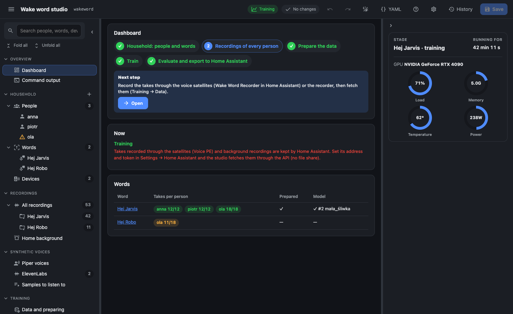

The screen has three columns: the **tree** on the left (what you want to see), the **view** in the middle (what
you chose) and the **right column** (the YAML of the selection, or the training live: stage, GPU, log). Every card has
its own `?` with a short description; the `?` in the top bar opens this documentation.

**Top bar** (from the left): ☰ menu (documentation, login, **Log out**) · the household folder's name · the
training state · the machine state and **Switch the machine off** · **No changes / Draft saved** · undo / redo ·
Discard · theme · **YAML** (the whole `household.yaml`) · `?` · ⚙ · **History** · **Save**.

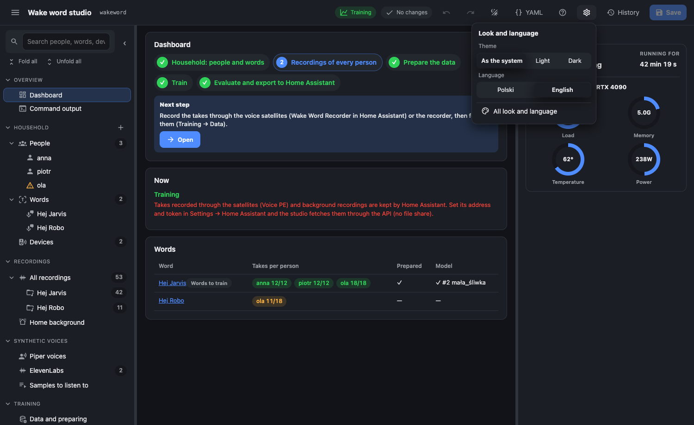

⚙ opens the **Look and language** pop-up: theme (As the system / Light / Dark) and language (Polski / English) work at
once; **All look and language** leads to the node Settings → Look and language.

| Group | Node | What it is for |
|---|---|---|
| **Overview** | Dashboard | the way from recordings to a model in 6 steps, **Next step** with an **Open** button, a table of words (takes per person, prepared, model) |
| | Command output | the result of the last command (prepare, evaluate, export) — exit code and the full log |
| **Household** | People | the household: id, group (adult / child), which words they say; ⚠ when takes are missing |
| | Words | wake words: name, **How it sounds** (spellings for the speech synthesis, per language), **Sounds similar (must not wake)**, who uses it, changing the id |
| | Devices | which Voice PE has which word (2 slots per device) — the export turns this into ready YAML |
| **Recordings** | All recordings / a word | listen, delete (to `data/backup`), the number of takes of each person |
| | Home background | recordings of silence, talk and TV at home — they teach the model when **not** to react |
| **Synthetic voices** | Piper voices | the speech synthesis voices that read your word; adding voices from Hugging Face |
| | ElevenLabs | extra, very natural voices (paid account, optional) |
| | Samples to listen to | how the synthesis says the word — check before you trust the training |
| **Training** | Data and preparing | **Sync with HA** (fetch the recordings) and **Prepare** (data for training) |
| | Parameters and start | steps, negative weight, learning rate, weights of the sets, presets, **Start training** |
| | Live progress | stage, GPU, chart, log, advice after the training |
| | Models | every training run of the word, ranking, **Choose** a base model, **Next training from scratch** |
| | Evaluation and export | **Evaluate on family takes**, **Cutoff**, **Export for ESPHome** (sends the models to HA) |
| **Home** | False wakes | (stage E8) the wake log from Home Assistant |
| **Settings** | Targets and language | how many takes per word an adult and a child record, how many are kept for the test |
| | Home Assistant | HA's address and token (fetching recordings, sending models) |
| | Machine power | the machine's switch in HA and switching off after training |
| | Machine and HF token | a check of the machine (GPU, Python, disk, tools), the Hugging Face token |
| | Login | who is logged in, how to change the password, Log out |
| | Look and language | the studio's theme and language in this browser |

**Saving.** Changes in Household, Settings and the voices go to a **draft** first (the "Draft saved" pill, undo /
redo). They reach `household.yaml` only with **Save** (Ctrl+S) — the dialog shows what changes. **History** keeps the
last 30 versions with restore. Details: [11.4 Draft, save and history](11-studio.md#draft-save-and-history).

## 13.2 The first word from scratch {#first-word}

Example: a family wants the word "Hey Jarvis". The order is the same as on the Dashboard.

### Step 1. Connect the studio to Home Assistant {#step-ha}

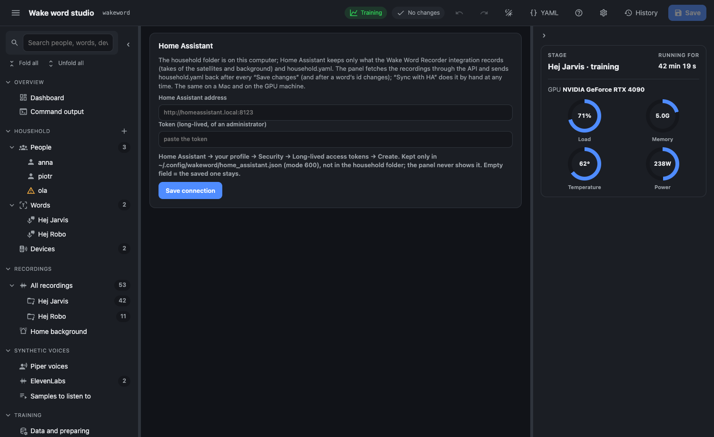

1. Tree → **Settings → Home Assistant**.
2. Enter HA's address (e.g. `http://homeassistant.local:8123`) and the long-lived token.
3. **Save** in the card. The studio checks the connection once. When HA rejects the token, the studio stops asking
   (so HA does not ban the machine for failed logins) and shows ⚠ at the node — fix the token and save again.

### Step 2. The household {#step-people}

1. **Household → People → Add person**: an id in lowercase (e.g. `anna`), group **adult** or **child** (children
   record more, see step 5).
2. Repeat for everyone who will say the word.
3. **Save** (top bar) — the dialog shows the added people.

### Step 3. The word {#step-word}

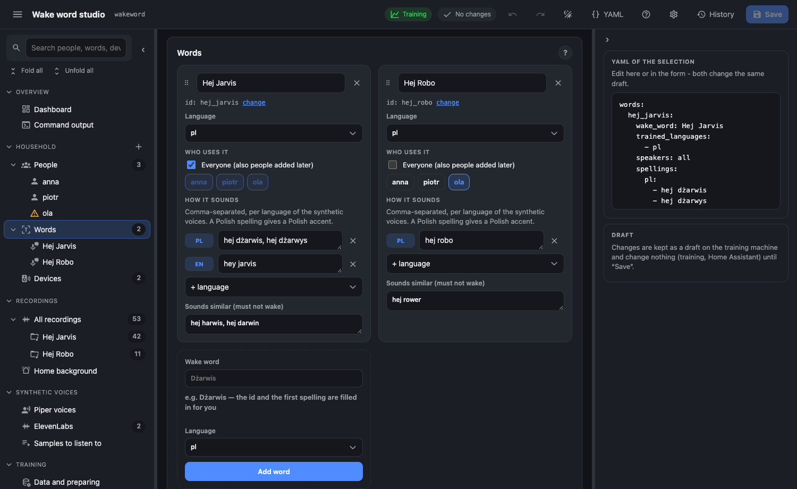

1. **Household → Words → Add word**: type the word as people write it, e.g. `Hey Jarvis`. The id (`hey_jarvis`) and
   the first spelling are filled in for you.
2. **How it sounds** — spellings for the speech synthesis, comma-separated, per language. A Polish spelling gives a
   Polish accent: `hej dżarwis, hej dżarwys`. For English voices add a language with **+ language** → `en`:
   `hey jarvis`.
3. **Sounds similar (must not wake)** — words the model must **not** react to, e.g. `hey darwin, jarmark`.
4. **Who uses it** — keep everyone or choose people.
5. **Save**. How to choose a good word: [12.2 Choosing the word](12-training-well.md#choosing-the-word).

### Step 4. Devices {#step-devices}

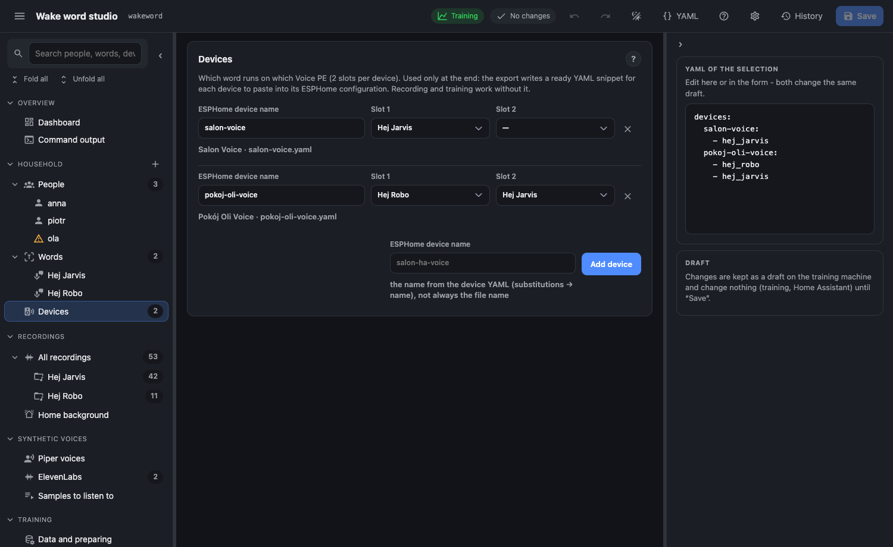

1. **Household → Devices → Add device** → **Pick from ESPHome** (the Voice PE list from Home Assistant) or type the
   name from the device YAML (`substitutions → name`).
2. At the device choose the word for **slot 1** (and optionally **slot 2**; Voice PE listens for two words).
3. **Save**. Devices are needed only for the export — you can add them later.

### Step 5. Recording targets {#step-targets}

**Settings → Targets and language**: how many takes of the word each person records (default adult 12, child 18) and
how many of them are kept for the test only (3). Recommended: adult 12–15, child 18–25 —
[12.3 How many recordings and which](12-training-well.md#how-many-recordings-and-which). **Save**.

### Step 6. Recording through Voice PE {#step-record}

1. On **Save** the studio sends `household.yaml` to Home Assistant — Wake Word Recorder knows the people and words.
2. In Home Assistant open the **Wake Word Recorder** device, choose the person and the word, press **Start**: Voice PE
   asks for each take (different distance, loudness, pace). The full description:
   [03. Recording through Voice PE](03-recording.md#recording-through-voice-pe-wake-word-recorder-in).
3. Record the **home background** too (about 30 min per room: a normal evening, TV, talk) —
   [03. Background recordings](03-recording.md#household-background-recordings-optional-but-wor).

### Step 7. Fetch the recordings {#step-sync}

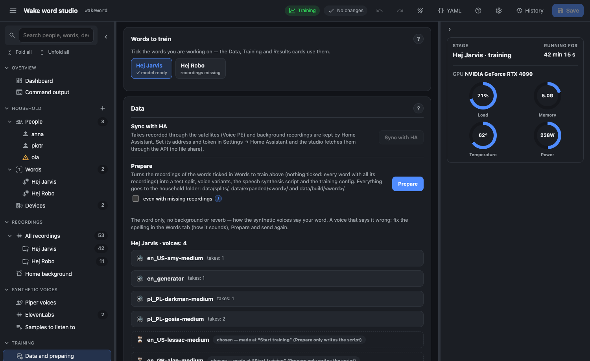

1. **Training → Data and preparing → Sync with HA**. The studio sends `household.yaml` and fetches only new
   recordings (ones deleted here are not fetched again).
2. Check **Recordings → Hey Jarvis**: everyone has their takes; listen to a few. Delete a bad take (cut off, another
   word) — it goes to `data/backup`.
   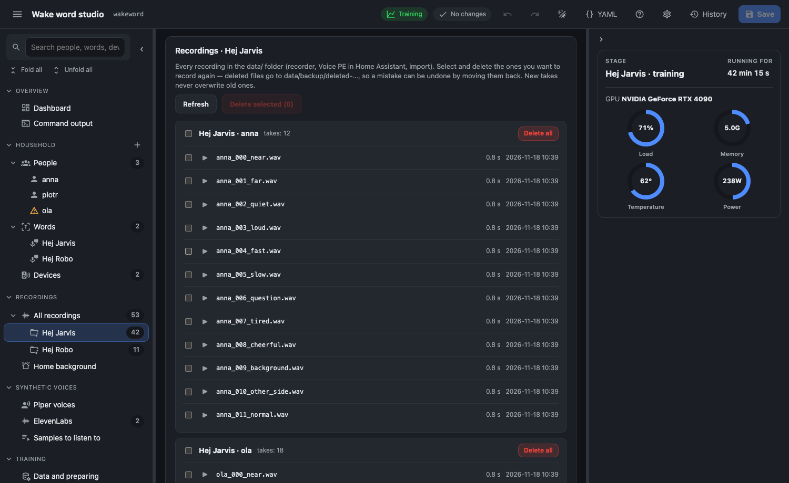

3. The Dashboard shows green counters at the word (e.g. `anna 12/12`) once the target is met.

### Step 8. Prepare {#step-prepare}

1. At the top of **Data and preparing** tick the word in **Words to train** (nothing ticked: every word with all its
   recordings).
2. **Prepare**. It makes the test split (3 takes of each person kept for the test), voice variants, the speech
   synthesis script and the training config. **Command output** shows e.g.:
   ```
   hey_jarvis: 56 train, 3 test → /data/household/data/splits/hey_jarvis.csv
   hey_jarvis: 336 expanded takes
   ```
3. Someone's takes are missing and you want a trial training? Tick **even with missing recordings**.

### Step 9. Parameters and start {#step-start}

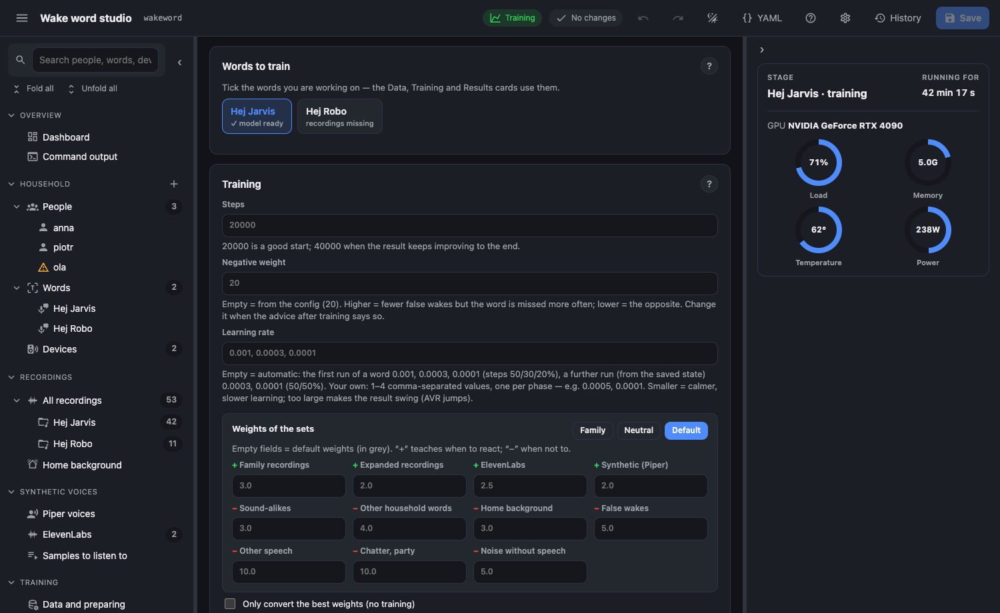

1. **Training → Parameters and start**. For the first training leave the fields empty (defaults: 20,000 steps,
   negative weight 20, automatic learning rate) or click the preset **Family** (a word for this family) /
   **Neutral** (a word for anyone).
2. Want the machine to switch itself off after the training? Tick **Switch the machine off when it ends** (right
   column).
3. **Start training**. The studio moves to **Live progress**.

What each parameter means: [12.6 Training parameters](12-training-well.md#training-parameters).

### Step 10. Live progress {#step-live}

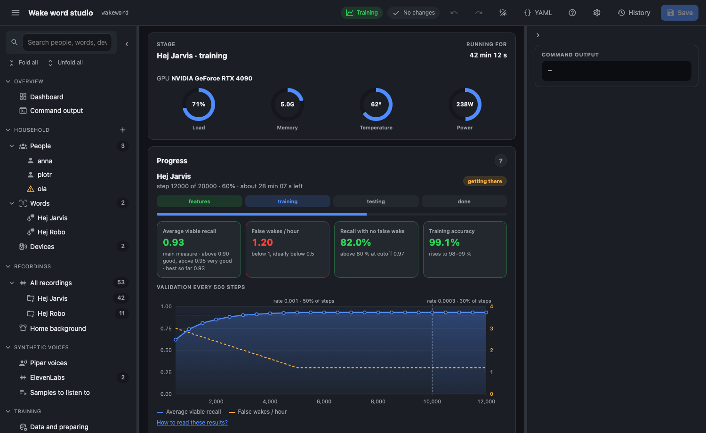

Stages: **features** (speech synthesis, voice variants, sound features) → **training** (steps, a chart of accuracy and
false wakes) → **final test** → **done**. The right column shows the GPU (load, memory, temperature, power) and the
log. After the training comes the **advice**: done, too few takes, too many false wakes or an unstable training —
with a **Set these values** button for the next training.

!!! note "How long it takes"
    On an RTX 4090: the first training of a word (with speech synthesis) about 1–2 h at 20,000 steps; later
    trainings of the same word are shorter because the synthesis and the features are ready. Checked on 18 Nov 2026: a
    trial training of a new word with 2,000 steps (with speech synthesis and features) took about 25 min, and the whole
    way Prepare → training → evaluation → export went through without errors.

### Step 11. Evaluate {#step-evaluate}

Described in [13.5 Evaluating a model](#evaluate).

### Step 12. Export and Voice PE {#step-export}

Described in [13.6 Export to Home Assistant](#export) and [13.7 The word on Voice PE](#voice-pe).

## 13.3 Adding a new word {#add-word}

When the family already has one word and wants a second (e.g. the children's "Hey Robo"):

1. **Household → Words → Add word** → name, **How it sounds**, **Sounds similar**, **Who uses it** (e.g. the children
   only). **Save**.
2. The word appears in the tree with ⚠ "takes missing" at people who have not recorded it yet.
3. Recordings through Voice PE (Wake Word Recorder knows the new word after the save) → **Sync with HA**.
4. **Data and preparing** → tick **only the new word** in "Words to train" → **Prepare**.
5. **Parameters and start** → **Start training**. The ticked words are trained one after another.
6. **Devices** → put the new word in slot 1 or 2 of the chosen Voice PEs → **Save**.

The first word is not trained again — every word has its own model.

**Changing a word's id** (e.g. a typo): **change** next to the id. The recordings folder is renamed and the prepared
data moved to `data/backup` — then **Prepare** again.

## 13.4 Training another word and training again {#train-again}

**Another word.** Tick another word (or several) in **Words to train** — Data, Parameters, Models and the export work on
the ticked ones. Every word is trained on its own; several ticked words are trained one after another in one run.

**The same word again** — when the result is poor or takes were added:

1. Takes or background added? **Sync with HA** → **Prepare** (the studio will not train on data older than the last
   change of the word — it says what changed).
2. **Parameters and start**: apply the advice of the last training (**Set these values**) or change one parameter at
   a time — recipes: [12.8 Reading the results](12-training-well.md#reading-the-results).
3. Where it starts: by default the next training **continues** the last model (a lower learning rate). In **Models**
   you can **Choose** another kept model as the start, or **Next training of "…" from scratch**.
4. **Only convert the best weights (no training)** — when you only want to convert and test the best saved state
   again (e.g. after a change of the test).

Every run stays on the **Models** list — nothing is lost.

## 13.5 Evaluating a model {#evaluate}

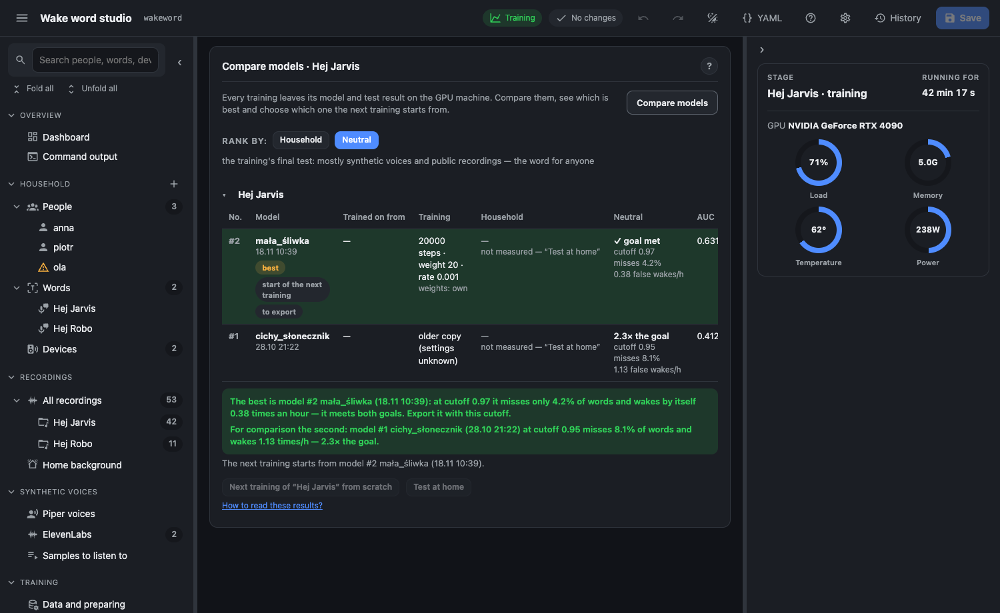

1. **Training → Models → Compare models**: a table of every run of the word. Columns: number and name of the run,
   what it continued from, the training settings, the **Household** result (your held-out takes), the **Neutral**
   result (the final test: synthetic voices and public recordings), **AUC**.
2. **Ranking by**: **Household** (a word for this family) or **Neutral** (a word for anyone). Badges: **best**,
   **start of the next training**, **to export**.
3. Below the table the studio says in plain words which model is best and at which cutoff, e.g. "at cutoff 0.97 it
   misses only 4.2% of words and wakes by itself 0.38 times an hour — meets both goals".
4. **Test at home** / **Training → Evaluation and export → Evaluate on family takes** — tests the kept models on the
   takes kept for the test and the test part of the home background. The result goes to the **Household** column.

**Goals:** at most **5% missed words** and at most **0.5 false wakes an hour** at one cutoff ("goal met").
"1.5× the goal" means the worse of the two numbers is one and a half times the goal. What to do with a poor result:
[12.8 Reading the results](12-training-well.md#reading-the-results) and
[07. Evaluation](07-evaluation.md#what-to-do-when-the-result-is-poor).

**Choosing the model to export:** click **Choose** at the model — the next training starts from it and it is the one
exported (badge "to export").

## 13.6 Export to Home Assistant {#export}

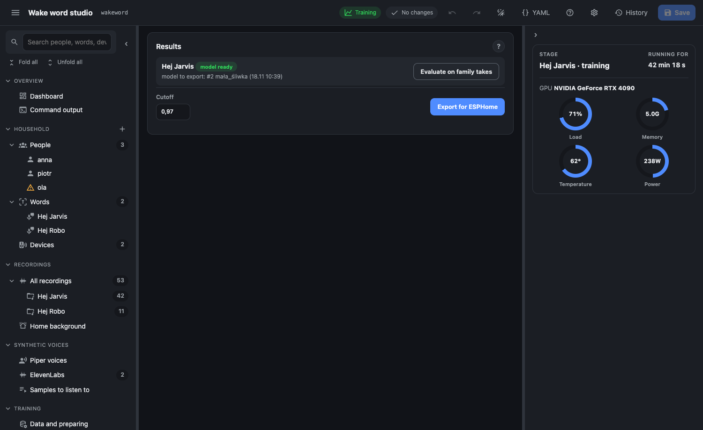

1. **Training → Evaluation and export**. The word shows which model will be exported.
2. **Cutoff** — enter the recommended cutoff from the evaluation (e.g. `0.97`). Higher = wakes by itself less often but
   sometimes misses; lower = the opposite. You can change the cutoff later without training — just export again.
3. **Export for ESPHome**. The studio exports **every trained word** and — when the Home Assistant connection is set —
   **sends** the files `<word>.tflite` and `<word>.json` to `/config/esphome/wake_words/` **by itself** (through the
   Wake Word Recorder API, no copying by hand).
4. **Command output** shows where the files went. Every device from step 4 gets **a ready YAML snippet**
   `data/export/devices/<device>.yaml` (with a Home Assistant connection the output shows it at once), e.g.:
   ```yaml
   # living-room-voice: wake words hey_jarvis — generated by `wakeword export`.
   # Paste below the existing `packages:` block of the device (keep the package as it is).
   micro_wake_word:
     models:
       - model: wake_words/hey_jarvis.json
         id: hey_jarvis

   # After flashing, in Home Assistant set:
   #   assistant slot 1 wake word: Hey Jarvis
   ```

Without a Home Assistant connection the files are in the household folder: `data/export/wake_words/` — copy them to
`/config/esphome/wake_words/` (Samba, File editor or `scp`). The manifest in detail: [08. Export](08-deployment.md#export).

## 13.7 The word on Voice PE {#voice-pe}

1. Home Assistant → **ESPHome Device Builder** → the Voice PE → **Edit**.
2. Paste the YAML snippet from the export **below** the existing `packages:` block (do not change the Voice PE
   package). The package's words (`okay_nabu`, `hey_jarvis`, `hey_mycroft`) stay — the new ones join the list.
3. **Validate** → **Install → Wirelessly**. Compiling and flashing take a few minutes.
4. **Settings → Devices & services → ESPHome → (the Voice PE)**: in **Wake word** (slot 1) choose *Hey Jarvis*; in
   **Wake word 2** optionally a second word. In the voice assistant settings choose which assistant answers which
   slot.
5. **Test at home:** everyone says the word from different places in the room; an evening with the TV shows the false
   wakes. Too many false wakes → a higher cutoff (export again, **Install** again); misses too often → a lower cutoff,
   or more takes and training again ([13.4](#train-again)).

A full example of a device YAML: [08. Device YAML](08-deployment.md#device-yaml).

## 13.8 Checklist {#checklist}

| Step | Where | Done when |
|---|---|---|
| Connection to HA | Settings → Home Assistant | no ⚠ at the node |
| People, word, devices | Household | **Save** showed the changes, the pill says "No changes" |
| Recordings | Wake Word Recorder in HA → **Sync with HA** | Dashboard: green counters at everyone |
| Preparing | Training → Data and preparing | Command output: exit 0, "train / test" |
| Training | Parameters and start → Live progress | stage "done", advice after the training |
| Evaluation | Models / Evaluation and export | "goal met", or you know what to improve |
| Export | Evaluation and export | Command output: `Home Assistant: …/wake_words/<word>.json` (without a HA connection: the files in `data/export/wake_words/`) |
| Voice PE | ESPHome Device Builder + the device page | the word chosen in HA, wakes for the family's voices |
