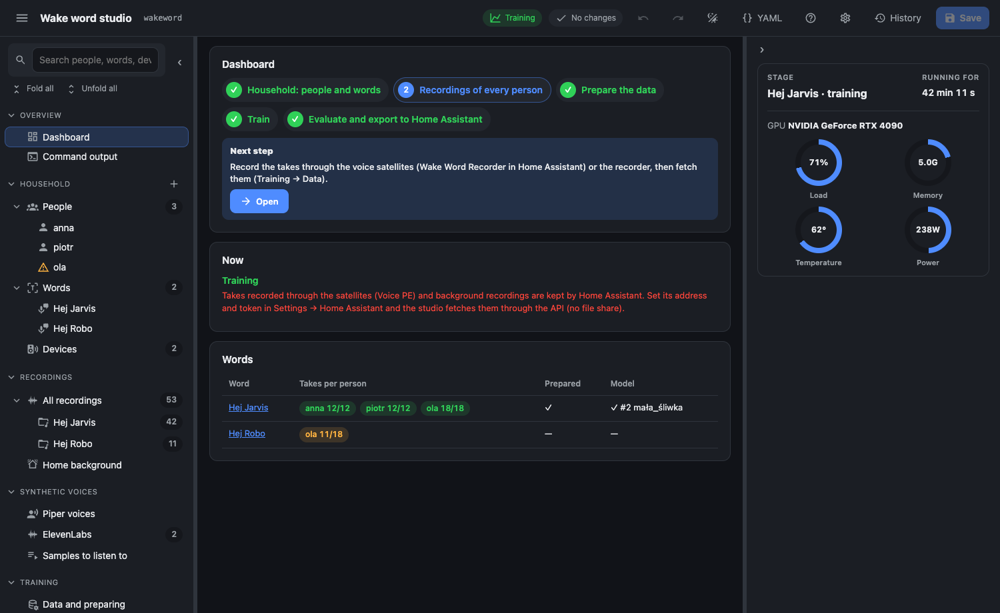

# Your own wake words for Home Assistant Voice {#start}

This project teaches Home Assistant Voice (Voice PE and other ESPHome satellites) **your own wake word** — e.g.
“Hey Jarvis” for the whole family or a word of their own for a child — so that it reacts to the household and does
not wake by itself from the TV or a conversation.

## How it works {#how-it-works}

1. **Household and words** — who speaks, which words, on which devices (`household.yaml`, in the studio:
   Household).
2. **Recordings** — the household records the word through a satellite (the Wake Word Recorder integration) or a
   phone; plus 30 minutes of each room's background.
3. **Synthetic data** — Piper voices and optionally ElevenLabs say the word and words that sound like it.
4. **Training on the GPU machine** — the studio in Docker on Ubuntu with an RTX 4090 prepares the data, trains a
   microWakeWord model and shows the progress live.
5. **Evaluation** — the household test on each person's held-out takes and the home's background: how many misses,
   how many false wakes a day.
6. **Deployment** — the studio sends the model to Home Assistant (`/config/esphome/wake_words/`), ESPHome puts it
   on the device.

Home Assistant switches the GPU machine on; the studio can switch it off — also by itself when a training ends.

## Where to start {#where-to-start}

| I want to… | Chapter |
|---|---|
| install the studio on the GPU machine and learn the screen | [The studio](11-studio.md) |
| step by step: every function, the first word, a new word, evaluating, export to HA and Voice PE | [The studio step by step](13-studio-step-by-step.md) |
| understand the whole road from recordings to a model | [Step by step](00-how-it-works.md) |
| know how many recordings, which parameters and what to change when the model errs | [Doing it well](12-training-well.md) |
| fix an error | [FAQ](faq.md) |
| look up the commands and the `household.yaml` syntax | [Cheat sheet](cheatsheet.md) |
| see everything changed to follow the shared standard of the apps | [The shared standard](standard.md) |

In the studio the **?** in the top bar opens this documentation, and the **?** of every card its part.
