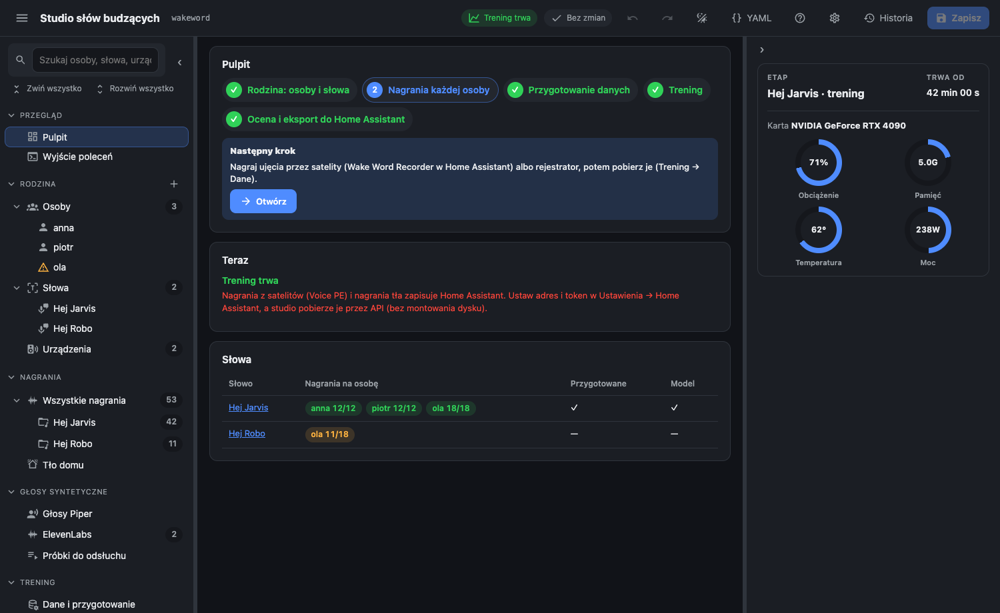
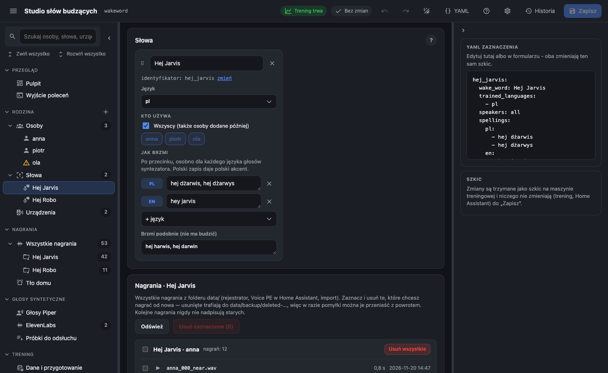
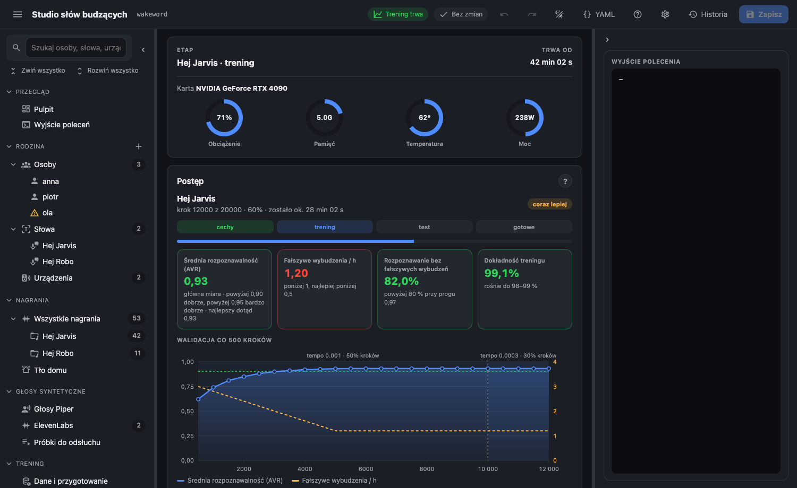
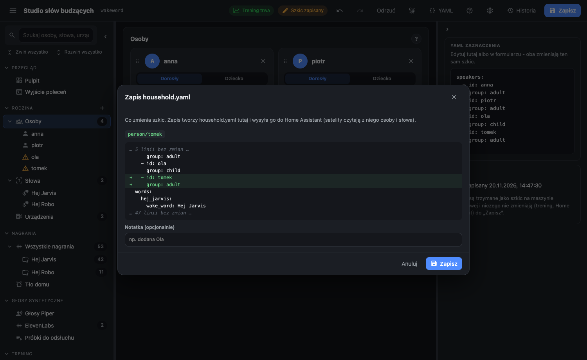
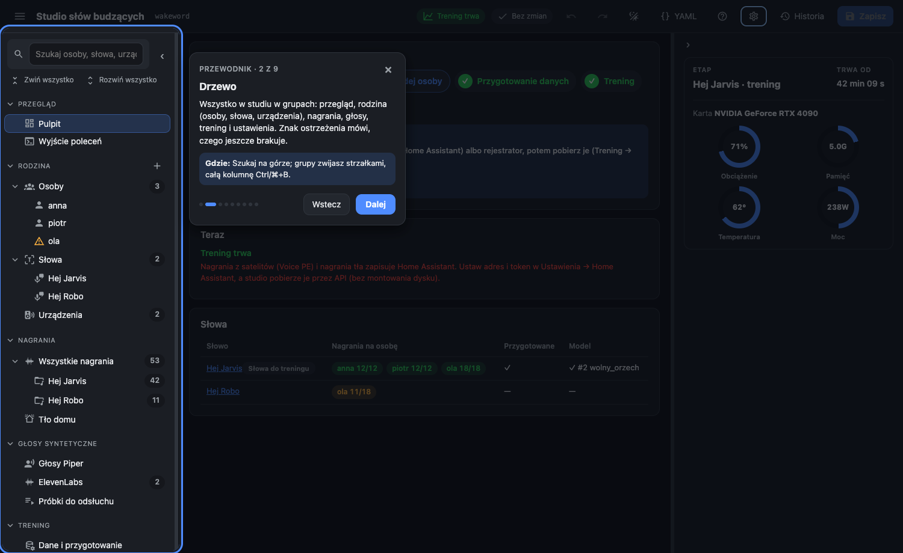
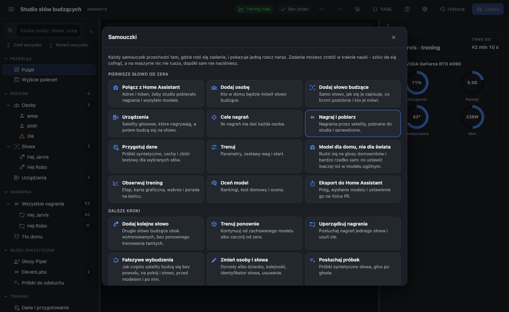
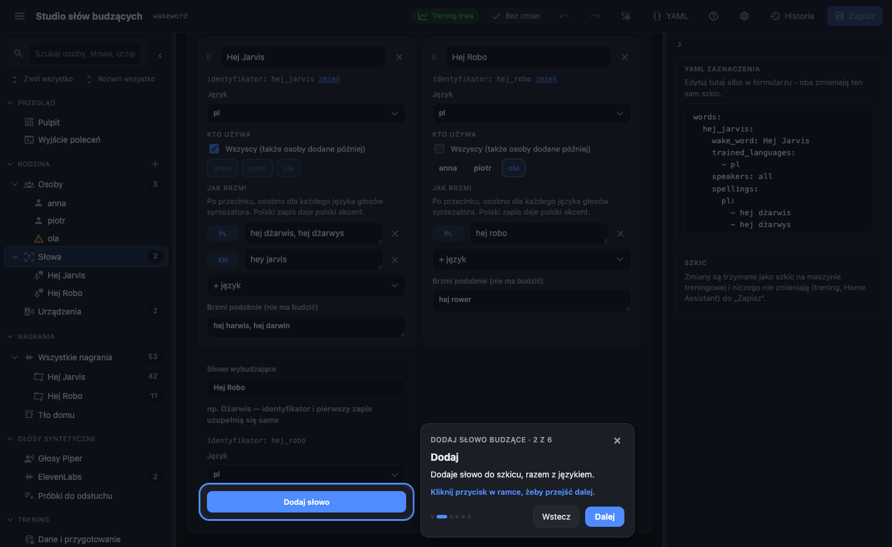
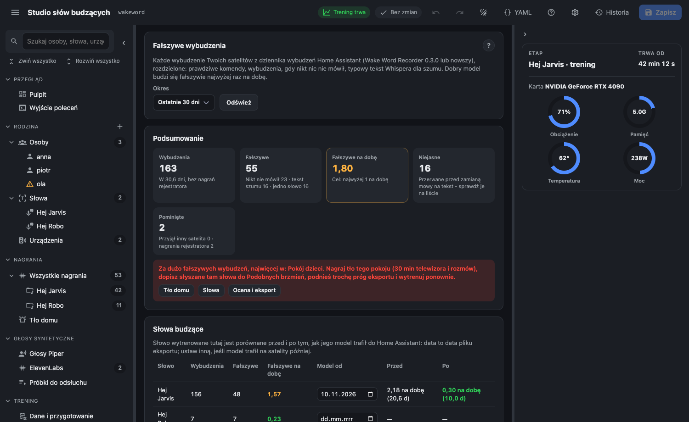

# 11. Studio słów budzących — edytor na maszynie z GPU (Docker) {#studio}

Studio to panel treningowy w postaci edytora, takiego samego jak Edytor Home Dashboard i Edytor Assist Router:
drzewo po lewej, widok w środku, YAML albo postęp treningu po prawej, szkic z cofaniem i historią. Działa
**wyłącznie na maszynie z kartą graficzną (Ubuntu + RTX 4090) w kontenerze Docker** i startuje razem z nią — po
włączeniu maszyny wystarczy otworzyć `http://<maszyna>:8765/`.

Wszystkie funkcje po kolei, od pierwszego słowa do Voice PE: [13. Studio krok po kroku](13-studio-step-by-step.md).

Na Macu studio można tylko wypróbować — zob. [Wypróbuj na Macu](#try-on-a-mac). Studio działa według wspólnego standardu aplikacji na maszynie z GPU
(te same polecenia `make`, logowanie, pasek górny i wyłączanie co trener Assist Routera i Piper Voice Cloner).

## Wypróbuj na Macu {#try-on-a-mac}

Wystarczy **Docker Desktop**, uruchomiony. Bez GPU, bez Pythona i bez Home Assistanta.

```bash
make demo        # buduje obraz demo (za pierwszym razem ok. 20 s) i go uruchamia
```

Otwórz `http://localhost:8766` i zaloguj się `demo` / `demo`. Wszystko jest udawane i zostaje w kontenerze: wymyślona
rodzina i udawane GPU, nic nie trafia do Home Assistanta ani na maszynę z GPU. Ctrl+C zatrzymuje i usuwa
kontener; `make demo-clean` usuwa też obraz. Dokumentacja: `make docs` (też w Dockerze). Dla programisty:
`make test` i `make test-browser` potrzebują `make setup` (uv, który sam pobiera Pythona; Chrome).

## 11.1 Instalacja na Ubuntu {#installing-on-ubuntu}

Potrzebne raz:

1. **Sterownik NVIDIA** — `nvidia-smi` musi pokazywać kartę (`sudo ubuntu-drivers install`, restart).
2. **Docker Engine i Compose** — [instrukcja Dockera dla Ubuntu](https://docs.docker.com/engine/install/ubuntu/),
   potem `sudo usermod -aG docker $USER` i ponowne zalogowanie.
3. **NVIDIA Container Toolkit** — [instrukcja NVIDIA](https://docs.nvidia.com/datacenter/cloud-native/container-toolkit/latest/install-guide.html),
   potem `sudo nvidia-ctk runtime configure --runtime=docker && sudo systemctl restart docker`.
4. **Miejsce na dysku** — ok. 60 GB: obraz (~12 GB z TensorFlow i CUDA), dane do augmentacji i negatywy
   (~30 GB w `docker/data/work`), nagrania i modele rodziny.

**Najprościej z Maca** (repozytorium na Macu, maszyna dostępna przez SSH bez hasła). Adres maszyny zapisz raz
dla wszystkich studiów w `~/.config/gpu-studio/host.mk`, a foldery tej aplikacji w `Makefile.local` (oba poza
gitem):

```make
# ~/.config/gpu-studio/host.mk
GPU_HOST = uzytkownik@192.168.1.21
```

```make
# Makefile.local - foldery z wcześniejszego treningu bez Dockera (puste = docker/data obok repozytorium)
STUDIO_HOUSEHOLD = ~/wakeword-train/household
STUDIO_WORK = ~/wakeword-work
STUDIO_HF = ~/.cache/huggingface
```

```bash
make install   # pierwszy raz: kod na maszynę, login, autostart, budowa i start
make login     # użytkownik i hasło
make deploy    # każda kolejna aktualizacja
make status    # czy odpowiada właściwa aplikacja (studio, nie demo), wersja, karta, TensorFlow na karcie
make logs      # log studia
make stop      # zatrzymaj studio; zostaje wyłączone także po restarcie (make deploy uruchamia je znowu)
make uninstall # usuń studio z maszyny: wypisuje, co usunie, i pyta o yes; nagrania i modele zostają
```

Potem `http://<maszyna>:8765/`. W studiu ustaw to, czego kontener nie bierze z Maca: Ustawienia → Home Assistant
(adres, token), Zasilanie maszyny i klucz ElevenLabs (Głosy → ElevenLabs).

Bez Maca, na samej maszynie:

```bash
git clone https://github.com/witold-gren/home-assistant-wakeword.git
cd home-assistant-wakeword
docker/install-ubuntu.sh
```

Skrypt sprawdza sterownik, Dockera i toolkit, przy pierwszym uruchomieniu **tworzy login** (`admin` i losowe
hasło w `docker/config/env`, prawa 600), włącza Dockera przy starcie systemu, buduje obraz i uruchamia kontener
z `restart: unless-stopped`. Na końcu pokazuje kartę widzianą w kontenerze i adres studia.

```bash
docker/install-ubuntu.sh --show-login   # użytkownik i hasło
docker/install-ubuntu.sh --remove       # zatrzymanie i usunięcie kontenera (dane zostają)
```

### Gdzie są dane {#where-the-data-is}

| Ścieżka na maszynie | W kontenerze | Co zawiera |
|---|---|---|
| `docker/data/household` | `/data/household` | `household.yaml`, nagrania (`data/real`, `data/background`), przygotowane dane, modele, szkic i historia edytora (`data/studio`) |
| `docker/data/work` | `/data/work` | zbiory negatywne i do augmentacji, generator głosów (pobierane przy pierwszym treningu) |
| `docker/data/huggingface` | `/home/wakeword/.cache/huggingface` | Hugging Face (token, pobrane pliki) |
| `docker/config` | `/home/wakeword/.config/wakeword` | login (`env`), połączenie z Home Assistant, klucz ElevenLabs, sekret sesji — **nigdy nie trafia do gita ani do obrazu** |

Foldery z wcześniejszego treningu (bez Dockera) można podpiąć zamiast `docker/data`:

```bash
STUDIO_HOUSEHOLD=~/wakeword-train/household STUDIO_WORK=~/wakeword-work STUDIO_HF=~/.cache/huggingface \
  docker/install-ubuntu.sh
```

Ścieżki trafiają do `docker/.env` i zostają przy kolejnych `make docker-up`.

Kopia zapasowa: wystarczy `docker/data/household` i `docker/config`; `work` i `cache` pobiorą się ponownie.

### Aktualizacja {#updating}

Na Macu, w repozytorium: `make deploy` (wysyła kod na `GPU_HOST` z `~/.config/gpu-studio/host.mk` i przebudowuje
kontener). Na samej maszynie: `git pull && make docker-up`. Trwający trening przerwie restart kontenera —
aktualizuj, gdy nic się nie trenuje.

### Dostęp spoza domu {#from-outside-the-home}

Studio nasłuchuje w sieci domowej na porcie 8765 i zawsze wymaga logowania. Nie wystawiaj portu do internetu —
spoza domu łącz się przez VPN (np. WireGuard).

## 11.2 Logowanie {#login}

Jeden użytkownik, zapisany jako `WAKEWORD_UI_AUTH=użytkownik:hasło` w `docker/config/env` (jak w Piper Voice
Cloner). Po zalogowaniu przeglądarka pamięta sesję 30 dni. Zmiana hasła: popraw plik i
`docker compose -f docker/compose.yaml restart` — wszyscy zostaną wylogowani. Po 5 złych hasłach z jednego adresu
studio czeka 60 s (bez trwałej blokady).

### Bez logowania w sieci domowej {#trusted-networks}

Logowanie chroni maszynę w chmurze (np. AWS). Jeśli używasz maszyny tylko w domu, możesz je wyłączyć dla swojej
sieci: `STUDIO_TRUSTED_NETWORKS=192.168.1.0/24` (Wasza sieć domowa; kilka sieci po przecinku) w `docker/config/env`
na maszynie, potem `make deploy` (albo przy instalacji: `make install STUDIO_TRUSTED_NETWORKS=192.168.1.0/24`).
Połączenie z tej sieci jest od razu zalogowane, a w menu zamiast „Wyloguj” widać „Bez logowania — ta sieć jest
zaufana”. Liczy się tylko adres połączenia, nie nagłówki, które dałoby się podrobić. **VPN:** jeśli Wasz VPN zamienia adresy klientów
na adres w sieci domowej (np. WireGuard z maskaradą), VPN też wchodzi bez logowania; inaczej dopisz sieć VPN. Z innych sieci
logowanie zostaje. Ta sama zmienna działa we wszystkich studiach na maszynie z GPU (wspólny standard).
Na maszynie w chmurze zostaw ją pustą.

## 11.3 Ekran {#the-screen}



- **Pasek górny**: menu (przewodnik, logowanie, wyloguj) · nazwa folderu rodziny · stan treningu · stan maszyny i
  **Wyłącz maszynę** · **Bez zmian / Szkic zapisany** · cofnij / ponów (Ctrl+Z, Ctrl+Shift+Z) · Odrzuć ·
  motyw (jak system / jasny / ciemny) · **YAML** (cały `household.yaml` szkicu) · `?` (ta dokumentacja, w nowej karcie) ·
  ⚙ (okienko pod przyciskiem: motyw i język od razu, „Cały wygląd i język” → węzeł Ustawienia → Wygląd i język,
  **Przewodnik po studiu** i **Samouczki** — [11.7](#tour-and-lessons)) ·
  **Historia** · **Zapisz** (Ctrl+S).
- **Drzewo** (szukaj, zwiń/rozwiń wszystko, liczniki, ⚠ ostrzeżenia):
  - **Przegląd** — Pulpit (droga od nagrań do modelu, następny krok, stan, słowa w skrócie), Wyjście poleceń (wynik
    ostatniego polecenia i log treningu z kopiowaniem).
  - **Rodzina** — Osoby (każda osoba: jej karta i nagrania), Słowa (każde słowo: karta i nagrania), Urządzenia.
    ⚠ przy osobie = brakuje jej nagrań; przy słowie = brak pisowni albo nikt go nie używa.
  - **Nagrania** — wszystkie, każde słowo osobno, tło domu: odsłuch, zaznaczanie, usuwanie do `data/backup`.
  - **Głosy syntetyczne** — głosy Piper (także z repozytorium Hugging Face), ElevenLabs, próbki do odsłuchu.
  - **Trening** — Dane i przygotowanie, Parametry i start, Postęp na żywo, Modele (każde słowo), Ocena i eksport.
  - **Dom** — Fałszywe wybudzenia ([11.8](#false-wakes)).
  - **Ustawienia** — Cele i język, Home Assistant, Zasilanie maszyny, Maszyna i token HF, Logowanie, Wygląd i język (motyw i język studia w tej przeglądarce).
- **Środek** — widok zaznaczenia. Każda karta ma jeden `?`: otwiera małe okienko z opisem tej karty (zamyka je
  ✕, Esc albo kliknięcie obok), na dole jest link „Więcej w przewodniku” do właściwego rozdziału. Pola mają
  podpowiedź pod spodem. Długie listy nagrań rysują się po rozwinięciu grupy, po 200 (**Pokaż kolejne**).
- **Zwijanie kolumn** — przycisk ‹ obok wyszukiwarki zwija drzewo, › na górze prawej kolumny zwija ją; zwinięta
  kolumna zostaje jako wąski pasek z przyciskiem rozwinięcia. Skróty: Ctrl/⌘+B (lewa), Ctrl/⌘+Alt+B (prawa).
  Przeglądarka pamięta zwinięcie; w wąskim oknie prawa kolumna jest zwinięta na start.
- **Prawa kolumna** — dla rodziny, głosów i celów: **YAML zaznaczenia** (edytowalny — formularz i YAML zmieniają
  ten sam szkic) i stan szkicu; dla treningu i ustawień: etap, czas, karta GPU (obciążenie, pamięć, temperatura,
  moc), wyjście polecenia i **Wyłącz maszynę po zakończeniu**.





## 11.4 Szkic, zapis i historia {#draft-save-and-history}

Każda zmiana rodziny (osoby, słowa, urządzenia, głosy, cele) trafia do **szkicu** zapisywanego na maszynie
(`data/studio/draft.json`) — przetrwa zamknięcie przeglądarki i restart, ale niczego nie zmienia (trening,
satelity w Home Assistant) do **Zapisz**. Okno zapisu pokazuje, co się zmieniło (dodane / usunięte / zmienione
osoby, słowa, urządzenia) i różnice w liniach `household.yaml`; można dodać notatkę. Zapis wysyła plik do
Home Assistant (Wake Word Recorder czyta z niego osoby i słowa).

Jeśli `household.yaml` zmienił się w międzyczasie (np. pobrany z Home Assistant), studio to pokaże, a zapis
poprosi o **Zapisz mimo to** — poprzednia wersja i tak zostaje w **Historii** (30 ostatnich wersji, z autorem i
notatką). Wersja z historii wraca jako szkic.



## 11.5 Wyłączanie maszyny {#switching-the-machine-off}

Maszyna jest włączana w Home Assistant (`switch.maszyna_gpu`, przykładowy pakiet
[`docs/home-assistant/maszyna_gpu.yaml`](../home-assistant/maszyna_gpu.yaml)) — gdy jest wyłączona, studia też nie
ma. Studio umie ją **wyłączyć**: przyciskiem w pasku górnym albo automatycznie — zaznacz **Wyłącz maszynę po
zakończeniu** w prawej kolumnie albo przy przycisku **Rozpocznij trening**.

- 120 s po końcu treningu — **udanym albo z błędem** — studio przełącza przełącznik w Home Assistant, a ten
  bezpiecznie wyłącza system i dopiero potem gniazdko.
- Odliczanie widać w pasku górnym („Wyłączenie za 1:45”) z przyciskiem **Anuluj**.
- Po ręcznym **Zatrzymaj** maszyna się **nie** wyłącza (pole zostaje zaznaczone na następny trening).
- Ocena, eksport albo polecenie uruchomione w czasie odliczania je wstrzymują; liczy się od nowa, gdy się skończą.
- Restart kontenera w czasie odliczania niczego nie wyłącza. Ustawienie działa raz — po wyłączeniu jest odznaczone.
- Błąd wyłączenia (np. brak tokenu) widać w pasku górnym.

Ustawienia: Ustawienia → Home Assistant (adres, token) i Zasilanie maszyny (przełącznik, czujnik mocy, próg W).

## 11.6 Pobieranie nagrań z Home Assistant {#fetching-recordings-from-home-assistant}

Nagrania z satelitów (Wake Word Recorder) studio pobiera przez API dodatku: **Trening → Dane i przygotowanie →
Synchronizuj z HA** (robi to też samo przy **Przygotuj**). Najpierw wysyła `household.yaml` do HA, potem
ściąga nowe ujęcia i nagrania tła; nagrania usunięte w studiu nie wracają. Potrzebny jest token długoterminowy
administratora (Ustawienia → Home Assistant). Odrzucony token (401) jest zapamiętywany i studio przestaje pytać HA
aż do ponownego **Zapisz** w tych ustawieniach — każde 401 to dla HA nieudane logowanie (`ip_ban`).

## 11.7 Przewodnik i samouczki {#tour-and-lessons}

Studio ma dwie pomoce do szybkiej nauki, tak jak Edytor Home Dashboard:

- **Przewodnik po studiu** — części ekranu po kolei w ramce (drzewo, środek, prawa kolumna, szkic i historia,
  Zapisz, maszyna, `?` i ⚙), reszta przyciemniona, a dymek mówi, co to jest i gdzie się to ustawia. Pokazuje się
  sam przy pierwszym otwarciu studia w przeglądarce; potem zawsze z **⚙ → Przewodnik po studiu**. Strzałki i Enter
  przechodzą dalej, Esc albo **Pomiń** kończą.



- **Samouczki** — **⚙ → Samouczki**: każde zadanie z [rozdziału 13](13-studio-step-by-step.md) jako krótki
  przewodnik, który sam przechodzi do właściwego węzła drzewa i pokazuje po jednej rzeczy. Tam, gdzie zmiana trafia
  tylko do szkicu (dodanie osoby albo słowa, otwarcie ⚙), samouczek **czeka, aż klikniesz przycisk w ramce** — zadanie
  robisz w trakcie nauki i możesz je cofnąć. Przyciski, które uruchamiają pracę maszyny albo coś wysyłają (pobierz,
  przygotuj, trenuj, eksportuj, wyłącz maszynę), samouczek tylko pokazuje z notką — naciskasz je sam. Przerobione
  samouczki są zaznaczone ✓ (pamięta to przeglądarka); samouczek, któremu czegoś brakuje (np. wytrenowanego słowa),
  jest wyszarzony i mówi czego. `?` na karcie ma przycisk **Pokaż krok po kroku** z samouczkiem tego miejsca.





| Grupa | Samouczki |
|---|---|
| Pierwsze słowo od zera | Połącz z Home Assistant, Dodaj osobę, Dodaj słowo budzące, Urządzenia, Cele nagrań, Nagraj i pobierz, Przygotuj dane, Trenuj, Model dla domu, nie dla świata, Obserwuj trening, Oceń model, Eksport do Home Assistant |
| Dalsze kroki | Dodaj kolejne słowo, Trenuj ponownie, Uporządkuj nagrania, Fałszywe wybudzenia, Zmień osoby i słowa, Posłuchaj próbek, Tło domu, Szkic, YAML i historia, Przegląd i zadania |
| Ustawiane raz | Zasilanie maszyny, Głosy Piper, Głosy ElevenLabs, Maszyna i konto, Wygląd i język |

## 11.8 Fałszywe wybudzenia {#false-wakes}

**Dom → Fałszywe wybudzenia** pokazuje każde wybudzenie Twoich satelitów z dziennika Home Assistant
(`/config/assist/wake_word_log.csv`, który zapisuje Wake Word Recorder). Studio pobiera go przez
`GET /api/wake_word_recorder/wake_log` — potrzebny jest **Wake Word Recorder 0.3.0 lub nowszy** i połączenie z
Home Assistant (Ustawienia → Home Assistant).



Każde wybudzenie trafia do jednego rodzaju:

| Rodzaj | Kiedy | Liczy się jako |
|---|---|---|
| komenda | zamiana mowy na tekst usłyszała prawdziwe polecenie | prawdziwe |
| nikt nie mówił (`no_speech`) | satelita się obudził, a tekst jest pusty | **fałszywe** |
| tekst szumu | typowy tekst Whispera dla ciszy i szumu („Dziękuję za oglądanie”, „do zobaczenia w kolejnych odcinkach”, „Koniec.”) | **fałszywe** |
| jedno słowo | jedno słowo, które nic nie zrobiło („Nie!”) | **fałszywe** |
| przerwane (`cancelled`) | przebieg skończył się przed zamianą mowy na tekst | niejasne — sprawdź na liście |
| duplikat | inny satelita przyjął to samo słowo — ktoś je naprawdę powiedział | pominięte |
| nagranie rejestratora | ujęcie nagrane przez Wake Word Recorder | pominięte |

- **Podsumowanie** — wybudzenia, fałszywe i **fałszywe na dobę** względem celu: najwyżej jedno na dobę
  ([rozdział 12](12-training-well.md)). Za dużo — podpowiedź, który pokój nagrać jako tło i co zmienić.
- **Słowa budzące** — dla słowa wytrenowanego w studiu porównanie **Przed** i **Po**: do dnia, w którym jego model
  trafił do Home Assistant, i od tego dnia. Dzień to data pliku eksportu (`data/export/wake_words/<słowo>.tflite`); jeśli
  wgrałeś model na satelity później, ustaw dzień ręcznie w kolumnie **Model od**.
- **Dzień po dniu**, **Satelity** i **Podejrzane wybudzenia** (najnowsze fałszywe i niejasne z godziną, pokojem i tym,
  co usłyszał Whisper) pokazują, co budzi urządzenia — telewizor wieczorem, zmywarka w nocy.

Co dalej z fałszywymi wybudzeniami: [9. Kolejne iteracje](09-iterating.md#false-wakes-new-negatives).
