# 13. Studio krok po kroku {#studio-step-by-step}

[← Studio](11-studio.md) · [Spis treści](index.md) · [Jak trenować dobrze →](12-training-well.md)

Ten rozdział prowadzi przez całe studio za rękę: co jest gdzie, jak od zera wytrenować pierwsze słowo,
jak dodać kolejne, jak trenować ponownie, jak ocenić model, jak wysłać go do Home Assistant i jak wgrać go
na Home Assistant Voice Preview Edition (Voice PE). Każdy krok mówi, **co kliknąć** i **co powinno się
pojawić**. Dlaczego coś działa tak, a nie inaczej, opisują rozdziały [12. Jak trenować dobrze](12-training-well.md)
i [00. Jak to działa](00-how-it-works.md).

!!! tip "Zanim zaczniesz"
    - Studio jest zainstalowane na maszynie z GPU i otwiera się w przeglądarce: `http://<maszyna>:8765/`
      ([11.1 Instalacja](11-studio.md#installing-on-ubuntu)). Użytkownika i hasło pokaże `make login`.
    - W Home Assistant działa integracja **Wake Word Recorder** (nagrywanie przez Voice PE) i masz
      **token długoterminowy** (Profil → Bezpieczeństwo → Tokeny długoterminowe).
    - Voice PE jest dodany w ESPHome (dodatek **ESPHome Device Builder**).
    - Każdy krok tego rozdziału ma w studiu samouczek: **⚙ → Samouczki** ([11.7](11-studio.md#tour-and-lessons)).

## 13.1 Mapa studia — wszystkie funkcje {#map}

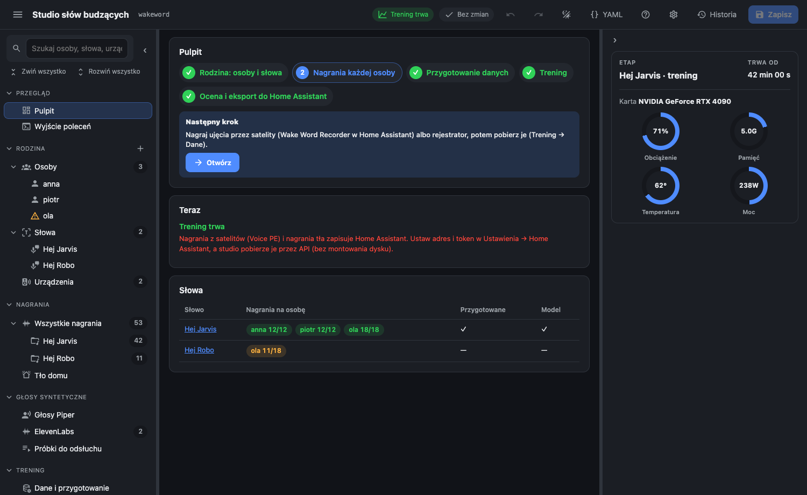

Ekran ma trzy kolumny: **drzewo** po lewej (co chcesz zobaczyć), **widok** w środku (to, co wybrałeś) i
**prawą kolumnę** (YAML zaznaczenia albo trening na żywo: etap, karta, log). Każda karta ma swój `?` z krótkim
opisem; `?` w pasku górnym otwiera tę dokumentację.

**Pasek górny** (od lewej): ☰ menu (dokumentacja, logowanie, **Wyloguj**) · nazwa folderu rodziny · stan
treningu · stan maszyny i **Wyłącz maszynę** · **Bez zmian / Szkic zapisany** · cofnij / ponów · Odrzuć ·
motyw · **YAML** (cały `household.yaml`) · `?` · ⚙ · **Historia** · **Zapisz**.

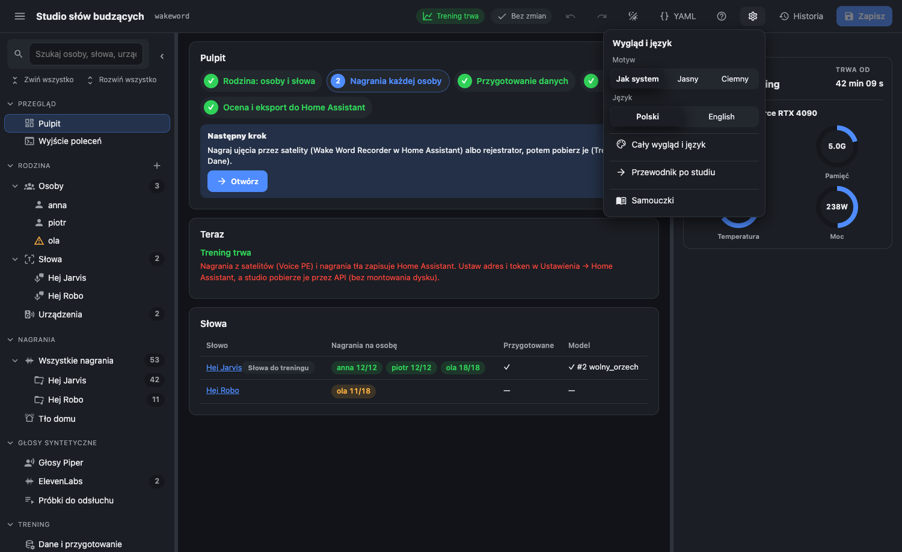

⚙ otwiera okienko **Wygląd i język**: motyw (Jak system / Jasny / Ciemny) i język (Polski / English) działają od
razu; **Cały wygląd i język** prowadzi do węzła Ustawienia → Wygląd i język.

| Grupa | Węzeł | Do czego służy |
|---|---|---|
| **Przegląd** | Pulpit | droga od nagrań do modelu w 6 krokach, **Następny krok** z przyciskiem **Otwórz**, tabela słów (nagrania na osobę, przygotowane, model) |
| | Wyjście poleceń | wynik ostatniego polecenia (przygotowanie, ocena, eksport) — kod wyjścia i pełny log |
| **Rodzina** | Osoby | domownicy: identyfikator, grupa (dorosły / dziecko), które słowa mówi; ⚠ gdy brakuje nagrań |
| | Słowa | słowa wybudzające: nazwa, **Jak brzmi** (zapisy dla syntezatora, osobno na język), **Brzmi podobnie (nie ma budzić)**, kto go używa, zmiana identyfikatora |
| | Urządzenia | które Voice PE ma które słowo (2 miejsca na urządzenie) — eksport robi z tego gotowy YAML |
| **Nagrania** | Wszystkie nagrania / słowo | odsłuch, usuwanie (do `data/backup`), liczba ujęć każdej osoby |
| | Tło domu | nagrania ciszy, rozmów i telewizora z domu — uczą model, kiedy **nie** reagować |
| **Głosy syntetyczne** | Głosy Piper | głosy syntezatora czytające Wasze słowo; dodawanie głosów z Hugging Face |
| | ElevenLabs | dodatkowe, bardzo naturalne głosy (płatne konto, opcjonalne) |
| | Próbki do odsłuchu | jak syntezator wymawia słowo — sprawdź, zanim zaufasz treningowi |
| **Trening** | Dane i przygotowanie | **Synchronizuj z HA** (pobranie nagrań) i **Przygotuj** (dane do treningu) |
| | Parametry i start | kroki, waga negatywów, tempo nauki, wagi zbiorów, presety, **Rozpocznij trening** |
| | Postęp na żywo | etap, karta graficzna, wykres, log, porada po treningu |
| | Modele | wszystkie przebiegi treningu słowa, ranking, **Wybierz** model bazowy, **Następny trening od zera** |
| | Ocena i eksport | **Oceń na nagraniach rodziny**, **Próg**, **Eksportuj dla ESPHome** (wysyła modele do HA) |
| **Dom** | Fałszywe wybudzenia | (etap E8) dziennik wybudzeń z Home Assistant |
| **Ustawienia** | Cele i język | ile nagrań na słowo ma zrobić dorosły i dziecko, ile odkładać do testu |
| | Home Assistant | adres i token HA (pobieranie nagrań, wysyłanie modeli) |
| | Zasilanie maszyny | przełącznik maszyny w HA i wyłączanie po treningu |
| | Maszyna i token HF | sprawdzenie maszyny (karta, Python, dysk, narzędzia), token Hugging Face |
| | Logowanie | kto jest zalogowany, jak zmienić hasło, Wyloguj |
| | Wygląd i język | motyw i język studia w tej przeglądarce |

**Zapisywanie.** Zmiany w Rodzinie, Ustawieniach i głosach trafiają najpierw do **szkicu** (pigułka „Szkic
zapisany”, cofnij / ponów). Do pliku `household.yaml` trafiają dopiero po **Zapisz** (Ctrl+S) — okno pokazuje,
co się zmieni. **Historia** trzyma 30 ostatnich wersji z przywracaniem. Szczegóły:
[11.4 Szkic, zapis i historia](11-studio.md#draft-save-and-history).

## 13.2 Pierwsze słowo od zera {#first-word}

Przykład: rodzina chce słowa „Hej Jarvis”. Kolejność jest taka sama jak na Pulpicie.

### Krok 1. Połącz studio z Home Assistant {#step-ha}

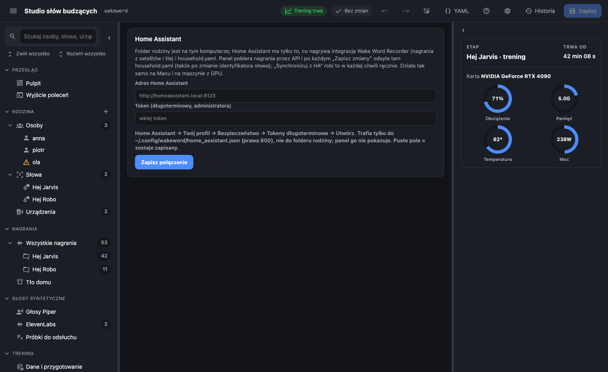

1. Drzewo → **Ustawienia → Home Assistant**.
2. Wpisz adres HA (np. `http://homeassistant.local:8123`) i token długoterminowy.
3. **Zapisz** w karcie. Studio raz sprawdza połączenie. Gdy HA odrzuci token, studio przestaje pytać (żeby HA nie
   zablokował maszyny za nieudane logowania) i pokazuje ⚠ przy węźle — popraw token i zapisz jeszcze raz.

### Krok 2. Domownicy {#step-people}

1. **Rodzina → Osoby → Dodaj osobę**: identyfikator małymi literami (np. `anna`), grupa **dorosły** albo
   **dziecko** (dzieci nagrywają więcej, patrz krok 5).
2. Powtórz dla każdej osoby, która będzie mówić słowo.
3. **Zapisz** (pasek górny) — okno pokazuje dodane osoby.

### Krok 3. Słowo {#step-word}

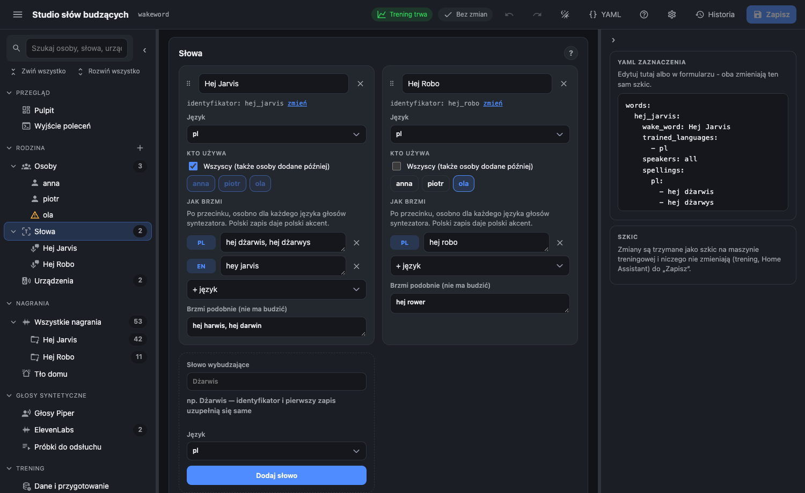

1. **Rodzina → Słowa → Dodaj słowo**: wpisz, jak słowo wygląda dla ludzi, np. `Hej Jarvis`. Identyfikator
   (`hej_jarvis`) i pierwszy zapis uzupełnią się same.
2. **Jak brzmi** — zapisy dla syntezatora, po przecinku, osobno dla każdego języka. Polski zapis daje polski
   akcent: `hej dżarwis, hej dżarwys`. Dla głosów angielskich dodaj język **+ język** → `en`: `hey jarvis`.
3. **Brzmi podobnie (nie ma budzić)** — słowa, na które model **nie** ma reagować, np. `hej darwin, jarmark`.
4. **Kto go używa** — zostaw wszystkich albo wybierz osoby.
5. **Zapisz**. Jak wybrać dobre słowo: [12.2 Wybór słowa](12-training-well.md#choosing-the-word).

### Krok 4. Urządzenia {#step-devices}

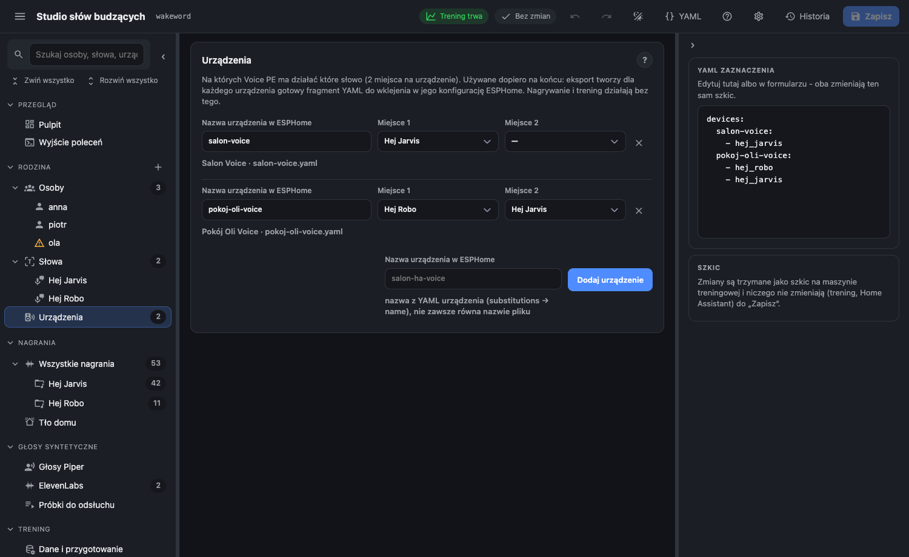

1. **Rodzina → Urządzenia → Dodaj urządzenie** → **Wybierz z ESPHome** (lista Voice PE z Home Assistant) albo
   wpisz nazwę z YAML urządzenia (`substitutions → name`).
2. Przy urządzeniu wybierz słowo dla **miejsca 1** (i opcjonalnie **miejsca 2**; Voice PE słucha dwóch słów).
3. **Zapisz**. Urządzenia są potrzebne dopiero przy eksporcie — możesz je dodać później.

### Krok 5. Cele nagrań {#step-targets}

**Ustawienia → Cele i język**: ile nagrań słowa robi każda osoba (domyślnie dorosły 12, dziecko 18) i ile z nich
odkładać tylko do testu (3). Zalecenia: dorosły 12–15, dziecko 18–25 —
[12.3 Ile nagrań i jakich](12-training-well.md#how-many-recordings-and-which). **Zapisz**.

### Krok 6. Nagrania przez Voice PE {#step-record}

1. Po **Zapisz** studio wysyła `household.yaml` do Home Assistant — Wake Word Recorder wie, jakie są osoby i słowa.
2. W Home Assistant otwórz urządzenie **Wake Word Recorder**, wybierz osobę i słowo, naciśnij **Start**: Voice PE
   prosi o kolejne ujęcia (różna odległość, głośność, tempo). Pełny opis:
   [03. Nagrywanie przez Voice PE](03-recording.md#recording-through-voice-pe-wake-word-recorder-in).
3. Nagraj też **tło domu** (po ok. 30 min na pokój: zwykły wieczór, telewizor, rozmowy) —
   [03. Nagrania tła](03-recording.md#household-background-recordings-optional-but-wor).

### Krok 7. Pobierz nagrania {#step-sync}

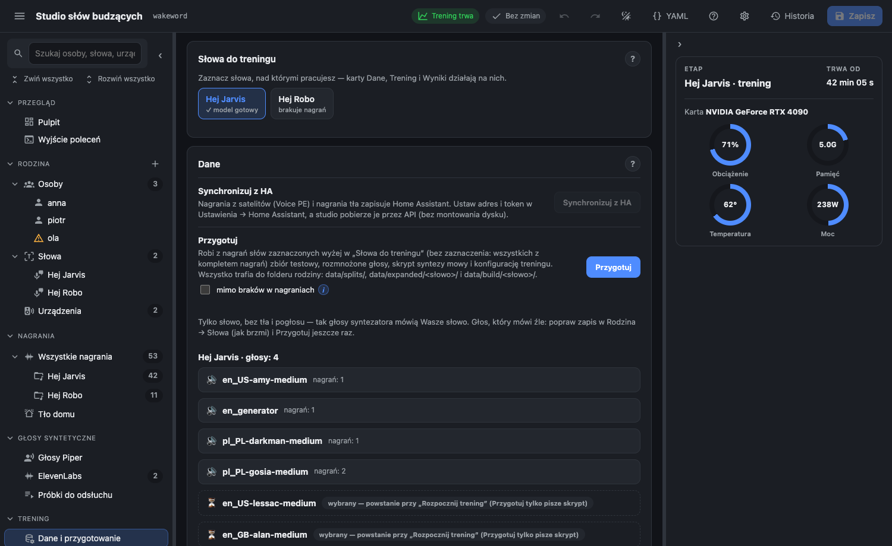

1. **Trening → Dane i przygotowanie → Synchronizuj z HA**. Studio wysyła `household.yaml` i pobiera tylko nowe
   nagrania (usuniętych tutaj nie ściąga ponownie).
2. Sprawdź **Nagrania → Hej Jarvis**: każda osoba ma swoje ujęcia; posłuchaj kilku. Złe ujęcie (urwane, inne słowo)
   usuń — trafi do `data/backup`.
   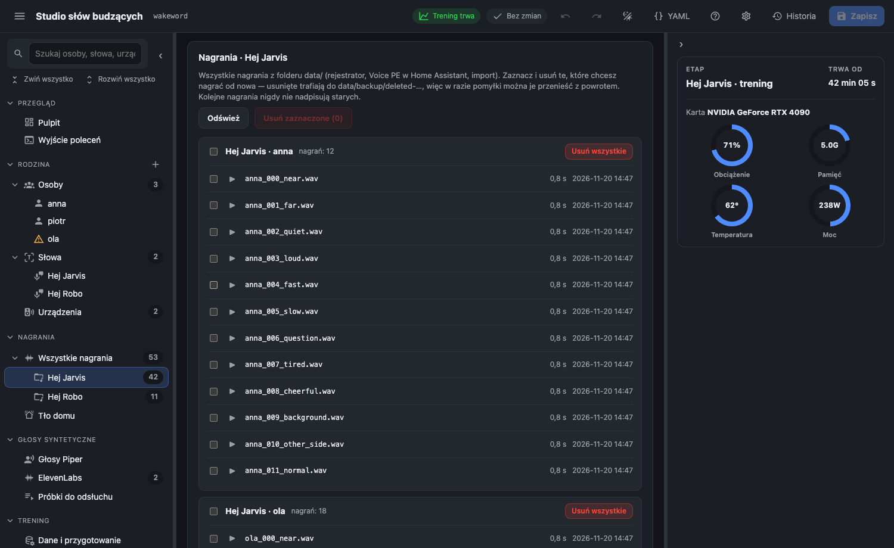

3. Pulpit pokazuje przy słowie zielone liczniki (np. `anna 12/12`), gdy cel jest spełniony.

### Krok 8. Przygotuj {#step-prepare}

1. Na górze widoku **Dane i przygotowanie** zaznacz słowo w **Słowa do treningu** (bez zaznaczenia: wszystkie
   słowa z kompletem nagrań).
2. **Przygotuj**. Powstaje zbiór testowy (3 ujęcia każdej osoby odłożone do testu), rozmnożone głosy, skrypt
   syntezy mowy i konfiguracja treningu. W **Wyjściu poleceń** zobaczysz m.in.:
   ```
   hej_jarvis: 56 train, 3 test → /data/household/data/splits/hej_jarvis.csv
   hej_jarvis: 336 expanded takes
   ```
3. Komuś brakuje nagrań, a chcesz trening próbny? Zaznacz **mimo braków w nagraniach**.

### Krok 9. Parametry i start {#step-start}

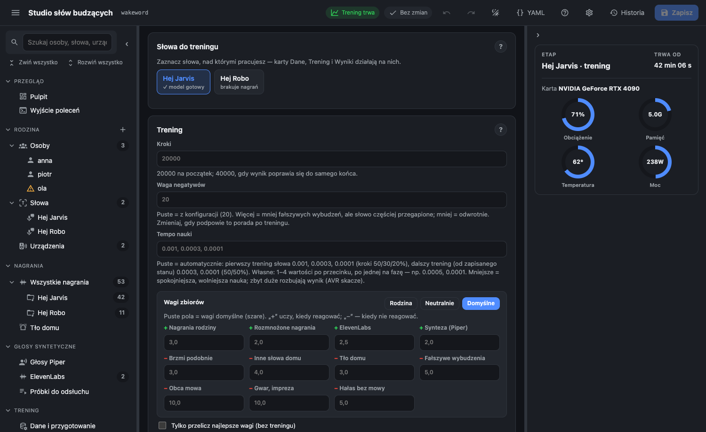

1. **Trening → Parametry i start**. Na pierwszy trening zostaw puste pola (domyślne: 20 000 kroków, waga
   negatywów 20, tempo nauki automatyczne) albo kliknij preset **Rodzina** (słowo dla tej rodziny) /
   **Neutralnie** (słowo dla każdego).
2. Chcesz, żeby maszyna wyłączyła się sama po treningu? Zaznacz **Wyłącz maszynę po zakończeniu** (prawa kolumna).
3. **Rozpocznij trening**. Studio przechodzi do **Postępu na żywo**.

Co znaczy każdy parametr: [12.6 Parametry treningu](12-training-well.md#training-parameters).

### Krok 10. Postęp na żywo {#step-live}

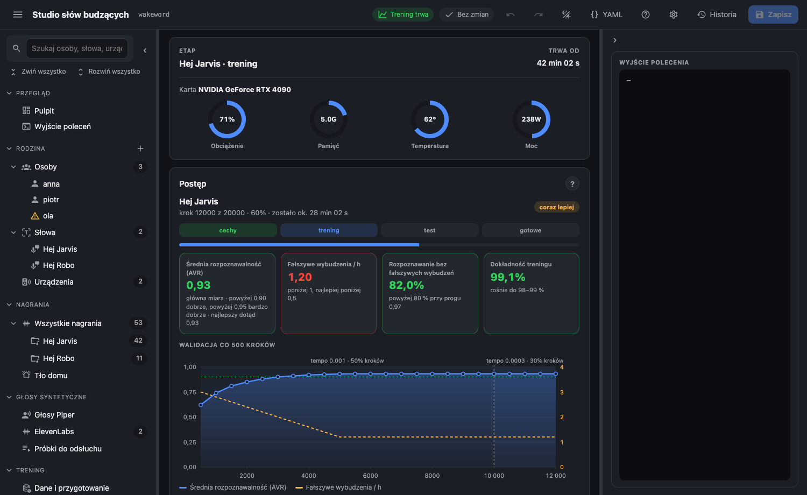

Etapy: **features** (synteza mowy, rozmnożenie głosów, cechy dźwięku) → **training** (kroki, wykres trafności i
fałszywych wybudzeń) → **test końcowy** → **gotowe**. Prawa kolumna pokazuje kartę (obciążenie, pamięć, temperatura,
moc) i log. Po treningu pojawia się **porada**: gotowe, za mało nagrań, za dużo fałszywych wybudzeń albo trening
niestabilny — z przyciskiem **Ustaw te wartości** na następny trening.

!!! note "Ile to trwa"
    Na RTX 4090: pierwszy trening słowa (z syntezą mowy) ok. 1–2 h przy 20 000 kroków; kolejne treningi tego
    samego słowa krócej, bo synteza i cechy są już gotowe. Sprawdzone 18.11.2026: próbny trening nowego słowa na 2000
    kroków (z syntezą mowy i cechami) trwał ok. 25 min, a cała droga Przygotuj → trening → ocena → eksport przeszła bez
    błędów.

### Krok 11. Oceń {#step-evaluate}

Opisane osobno w [13.5 Ocena modelu](#evaluate).

### Krok 12. Eksport i Voice PE {#step-export}

Opisane osobno w [13.6 Eksport do Home Assistant](#export) i [13.7 Słowo na Voice PE](#voice-pe).

## 13.3 Dodanie nowego słowa {#add-word}

Gdy rodzina ma już jedno słowo i chce drugie (np. dzieci „Hej Robo”):

1. **Rodzina → Słowa → Dodaj słowo** → nazwa, **Jak brzmi**, **Brzmi podobnie**, **Kto go używa** (np. tylko
   dzieci). **Zapisz**.
2. Słowo pojawia się w drzewie z ⚠ „brakuje nagrań” przy osobach, które jeszcze go nie nagrały.
3. Nagrania przez Voice PE (Wake Word Recorder ma już nowe słowo po zapisie) → **Synchronizuj z HA**.
4. **Dane i przygotowanie** → zaznacz **tylko nowe słowo** w „Słowa do treningu” → **Przygotuj**.
5. **Parametry i start** → **Rozpocznij trening**. Trenowane są zaznaczone słowa, po kolei.
6. **Urządzenia** → przypisz nowe słowo do miejsca 1 albo 2 wybranych Voice PE → **Zapisz**.

Pierwsze słowo nie jest przy tym trenowane od nowa — każde słowo ma osobny model.

**Zmiana identyfikatora słowa** (np. literówka): przy słowie **zmień** obok identyfikatora. Folder nagrań zostanie
przemianowany, a przygotowane dane przeniesione do `data/backup` — potem **Przygotuj** jeszcze raz.

## 13.4 Trening innego słowa i ponowny trening {#train-again}

**Inne słowo.** W **Słowa do treningu** zaznacz inne słowo (albo kilka) — Dane, Parametry, Modele i eksport
działają na zaznaczonych. Każde słowo trenuje się osobno; kilka zaznaczonych trenuje się po kolei w jednym
przebiegu.

**To samo słowo jeszcze raz** — gdy wynik jest słaby albo doszły nagrania:

1. Doszły nagrania lub tło? **Synchronizuj z HA** → **Przygotuj** (studio nie pozwoli trenować na danych starszych
   niż ostatnia zmiana słowa — powie, co się zmieniło).
2. **Parametry i start**: zastosuj poradę z poprzedniego treningu (**Ustaw te wartości**) albo zmień jeden parametr
   naraz — przepisy: [12.8 Czytanie wyników](12-training-well.md#reading-the-results).
3. Od czego zacząć: domyślnie kolejny trening **kontynuuje** ostatni model (mniejsze tempo nauki). W **Modele**
   możesz **Wybierz** inny zachowany model jako start albo **Następny trening „…” od zera**.
4. **Tylko przelicz najlepsze wagi (bez treningu)** — gdy chcesz tylko ponownie przeliczyć i przetestować
   najlepszy zapisany stan (np. po zmianie testu).

Każdy przebieg zostaje na liście **Modele** — nic nie ginie.

## 13.5 Ocena modelu {#evaluate}

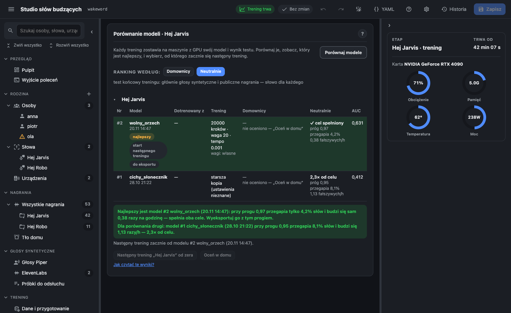

1. **Trening → Modele → Porównaj modele**: tabela wszystkich przebiegów słowa. Kolumny: numer i nazwa przebiegu,
   od czego był dotrenowany, ustawienia treningu, wynik **Domownicy** (Wasze odłożone nagrania), wynik
   **Neutralnie** (test końcowy: głosy syntetyczne i publiczne nagrania), **AUC**.
2. **Ranking według**: **Domownicy** (słowo dla tej rodziny) albo **Neutralnie** (słowo dla każdego). Plakietki:
   **najlepszy**, **start następnego treningu**, **do eksportu**.
3. Pod tabelą studio pisze zwykłym językiem, który model jest najlepszy i przy jakim progu, np. „przy progu 0,97
   przegapia tylko 4,2% słów i budzi się sam 0,38 razy na godzinę — spełnia oba cele”.
4. **Oceń w domu** / **Trening → Ocena i eksport → Oceń na nagraniach rodziny** — sprawdza zachowane modele na
   ujęciach odłożonych do testu i testowej części tła domu. Wynik trafia do kolumny **Domownicy**.

**Cele:** najwyżej **5% przegapionych słów** i najwyżej **0,5 fałszywego wybudzenia na godzinę** przy jednym progu
(„cel spełniony”). „1,5× od celu” znaczy, że gorsza z tych dwóch liczb jest półtora raza większa od celu.
Co zrobić przy słabym wyniku: [12.8 Czytanie wyników](12-training-well.md#reading-the-results) i
[07. Ocena](07-evaluation.md#what-to-do-when-the-result-is-poor).

**Wybór modelu do eksportu:** przy wybranym modelu kliknij **Wybierz** — następny trening zacznie od niego i to on
będzie eksportowany (plakietka „do eksportu”).

## 13.6 Eksport do Home Assistant {#export}

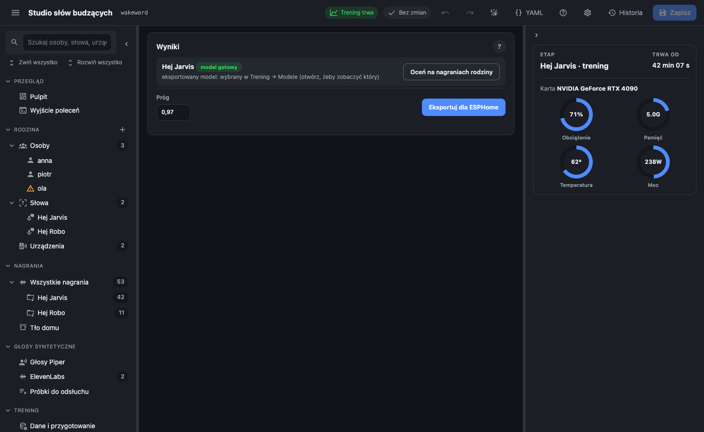

1. **Trening → Ocena i eksport**. Przy słowie widać, który model będzie eksportowany.
2. **Próg** — wpisz proponowany próg z oceny (np. `0,97`). Wyższy = rzadziej budzi się sam, ale czasem przegapi;
   niższy = odwrotnie. Próg zmienisz później bez treningu — wystarczy ponowny eksport.
3. **Eksportuj dla ESPHome**. Studio eksportuje **wszystkie wytrenowane słowa** i — gdy połączenie z Home Assistant
   jest ustawione — **samo wysyła** pliki `<słowo>.tflite` i `<słowo>.json` do `/config/esphome/wake_words/`
   (przez API Wake Word Recorder, bez kopiowania ręcznego).
4. **Wyjście poleceń** pokazuje, gdzie trafiły pliki. Dla każdego urządzenia z kroku 4 powstaje **gotowy fragment
   YAML** `data/export/devices/<urządzenie>.yaml` (z połączeniem z HA wyjście pokazuje go od razu), np.:
   ```yaml
   # salon-voice: wake words hej_jarvis — generated by `wakeword export`.
   # Paste below the existing `packages:` block of the device (keep the package as it is).
   micro_wake_word:
     models:
       - model: wake_words/hej_jarvis.json
         id: hej_jarvis

   # After flashing, in Home Assistant set:
   #   assistant slot 1 wake word: Hej Jarvis
   ```

Bez połączenia z HA pliki są w folderze rodziny: `data/export/wake_words/` — skopiuj je do
`/config/esphome/wake_words/` (Samba, File editor albo `scp`). Szczegóły manifestu:
[08. Eksport](08-deployment.md#export).

## 13.7 Słowo na Voice PE {#voice-pe}

1. Home Assistant → **ESPHome Device Builder** → urządzenie Voice PE → **Edit**.
2. Wklej fragment YAML z eksportu **pod** istniejącym blokiem `packages:` (pakietu Voice PE nie zmieniaj). Słowa
   z pakietu (`okay_nabu`, `hey_jarvis`, `hey_mycroft`) zostają — nowe dochodzą do listy.
3. **Validate** → **Install → Wirelessly**. Kompilacja i wgranie trwają kilka minut.
4. **Ustawienia → Urządzenia i usługi → ESPHome → (Voice PE)**: w polu **Słowo aktywujące** (miejsce 1) wybierz
   *Hej Jarvis*; w **Słowo aktywujące 2** opcjonalnie drugie słowo. W ustawieniach asystenta głosowego wybierz,
   który asystent odpowiada na które miejsce.
5. **Test w domu:** każdy domownik mówi słowo z różnych miejsc pokoju; wieczór z telewizorem pokaże fałszywe
   wybudzenia. Za dużo fałszywych → wyższy próg (ponowny eksport, ponowne **Install**); za często przegapia →
   niższy próg albo więcej nagrań i ponowny trening ([13.4](#train-again)).

Pełny przykład YAML urządzenia: [08. YAML urządzenia](08-deployment.md#device-yaml).

## 13.8 Lista kontrolna {#checklist}

| Krok | Gdzie | Gotowe, gdy |
|---|---|---|
| Połączenie z HA | Ustawienia → Home Assistant | brak ⚠ przy węźle |
| Osoby, słowo, urządzenia | Rodzina | **Zapisz** pokazało zmiany, pigułka „Bez zmian” |
| Nagrania | Wake Word Recorder w HA → **Synchronizuj z HA** | Pulpit: zielone liczniki przy każdej osobie |
| Przygotowanie | Trening → Dane i przygotowanie | Wyjście poleceń: kod 0, „train / test” |
| Trening | Parametry i start → Postęp na żywo | etap „gotowe”, porada po treningu |
| Ocena | Modele / Ocena i eksport | „cel spełniony” albo wiesz, co poprawić |
| Eksport | Ocena i eksport | Wyjście poleceń: `Home Assistant: …/wake_words/<słowo>.json` (bez połączenia z HA: pliki w `data/export/wake_words/`) |
| Voice PE | ESPHome Device Builder + strona urządzenia | słowo wybrane w HA, budzi się na głos rodziny |
