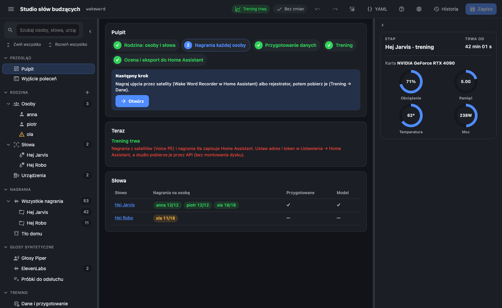

# Własne słowa budzące dla Home Assistant Voice {#start}

Ten projekt uczy Home Assistant Voice (Voice PE i inne satelity ESPHome) **własnego słowa budzącego** — np.
„Hej Dżarwis” dla całej rodziny albo osobnego słowa dla dziecka — tak, żeby reagowało na domowników, a nie
budziło się samo od telewizora czy rozmowy.

## Jak to działa {#how-it-works}

1. **Rodzina i słowa** — kto mówi, jakie słowa, na których urządzeniach (`household.yaml`, w studiu: Rodzina).
2. **Nagrania** — domownicy nagrywają słowo przez satelitę (integracja Wake Word Recorder) albo telefon; do tego
   30 minut tła każdego pokoju.
3. **Dane syntetyczne** — głosy Piper i opcjonalnie ElevenLabs mówią słowo i podobnie brzmiące słowa.
4. **Trening na maszynie z GPU** — studio w Dockerze na Ubuntu z RTX 4090 przygotowuje dane, trenuje model
   microWakeWord i pokazuje postęp na żywo.
5. **Ocena** — test domowy na odłożonych nagraniach każdej osoby i tle domu: ile przegapień, ile fałszywych
   wybudzeń na dobę.
6. **Wdrożenie** — studio wysyła model do Home Assistant (`/config/esphome/wake_words/`), ESPHome wgrywa go na
   urządzenie.

Maszynę z GPU włącza Home Assistant; studio umie ją wyłączyć — także samo po zakończeniu treningu.

## Od czego zacząć {#where-to-start}

| Chcę… | Rozdział |
|---|---|
| zainstalować studio na maszynie z GPU i poznać ekran | [Studio](11-studio.md) |
| krok po kroku: wszystkie funkcje, pierwsze słowo, nowe słowo, ocena, eksport do HA i Voice PE | [Studio krok po kroku](13-studio-step-by-step.md) |
| zrozumieć całą drogę od nagrań do modelu | [Krok po kroku](00-how-it-works.md) |
| wiedzieć, ile nagrań, jakie parametry i co zmienić, gdy model się myli | [Jak robić to dobrze](12-training-well.md) |
| naprawić błąd | [FAQ](faq.md) |
| sprawdzić polecenia i składnię `household.yaml` | [Ściąga](cheatsheet.md) |
| zobaczyć wszystko, co zmieniono, żeby spełnić wspólny standard aplikacji | [Wspólny standard](standard.md) |

W studiu przycisk **?** w pasku górnym otwiera tę dokumentację, a **?** przy każdej karcie — jej fragment.
